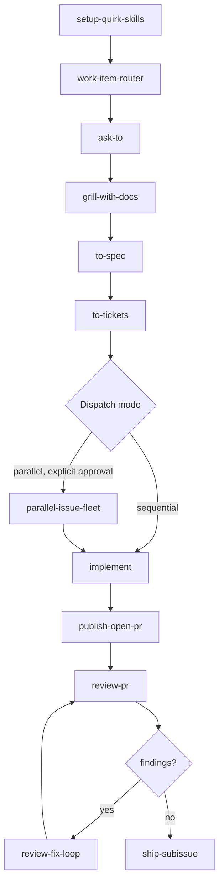
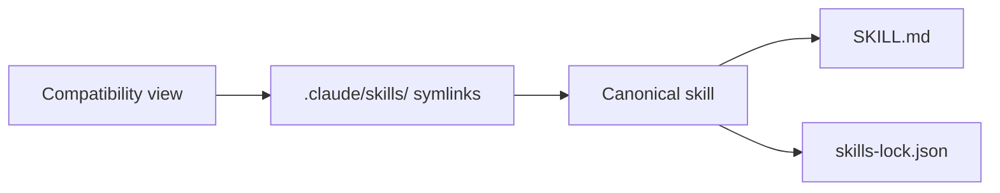

<p align="center">
  
  
  
</p>

<p align="center">
  
</p>

<p align="center">
  
  
  
</p>

`quirk Skills` is a repository-local workflow system for moving software work from intent to validated delivery.

It follows the `quirk` method: engineering preflight is mandatory before software changes, then clarify before building, preserve context, split work into claimable slices, trace requirements through architecture/design, QA/security/operations, implementation, gates, review and release, repair with explicit plans, and ship only on clean evidence.

If a PR branch is conflicted, resolve branch state first with `resolving-merge-conflicts`, then return to `review-pr` and `review-fix-loop` before shipping.

[Quick Start](#quick-start) · [Flow](#core-flow) · [Architecture](#architecture) · [Docs](#documentation) · [Quality](#quality--validation) · [Install](#installation--sync) · [Contribute](#contributing) · [License](#license)

<a id="quick-start"></a>

## 🚀 Quick Start

```bash
git clone https://github.com/quantumquirkxyz/skills-quirk.git
cd skills-quirk
# Node.js 18+ and Bash are required; CI uses Node.js 20.
node .agents/skills/platform/check-all.mjs
```

Run commands from the repository root. The core validation tools use Node.js built-ins and do not require `npm install`. A successful validation prints `status: "pass"`; resolve reported failures before treating the bundle as ready.

Install the bundle into another repository with a dry run first:

```bash
# Existing repository-safe preview: reports conflicts and writes nothing.
node .agents/skills/platform/sync-bundle.mjs /path/to/target-repo

# Apply only after reviewing the dry run.
node .agents/skills/platform/sync-bundle.mjs /path/to/target-repo --write
```

For a brand-new disposable target where replacing starter docs is acceptable, the legacy `scripts/install-quirk-skills.sh` is available but destructive. For any repository that already has a `README.md`, `CONTEXT.md`, ADRs, or local docs, use the dry-run sync plus the existing-repository prompt in [Installation & Sync](#installation--sync).

Follow the [adoption guide](docs/how-to/adoption.md) to configure local context, then invoke `engineering-preflight` for software-changing work before `ask-to` or any implementation, ticketing, or publication skill. Documentation, research, and hotfix exceptions require rationale, approver, expiry, and post-change verification. Skill names describe agent instructions, not shell commands.

<details>
<summary>What the bundle includes</summary>

- **Legacy setup automation** — `scripts/setup-quirk-skills.sh` (destructive; use sync/adopt for first installation)
- **Canonical auxiliary skills** — `.agents/skills/auxiliary/integration-playground`, `.agents/skills/skill-dev/skill-testing-framework`, and foundation skills: `agent-canvas`, `context-engine`, `mcp-server`, `subagent-swarm`
- **CI validation** — `.github/workflows/validate.yml`
- **Skill evolution** — `skill-lab.mjs` and `skill-evolver.mjs`
- **Skills manifest** — `skills.json` for portable bundle definition and agent discovery
- **Work-item routing** — `work-item-router.mjs` for keyword-based skill selection

</details>

## Table of Contents

- [About](#about)
- [Core Flow](#core-flow)
- [Architecture](#architecture)
- [Method](#method)
- [Documentation](#documentation)
- [Quality & Validation](#quality--validation)
- [Distribution](#distribution)
- [Installation & Sync](#installation--sync)
- [Governance](#governance)
- [Contributing](#contributing)
- [Security](#security)
- [License](#license)

<a id="about"></a>

## About

> A portable skills stack for standard project development. Install it into a repository, then specialize it through that repo's own `CONTEXT.md`, ADRs, issue tracker configuration, validation commands, and stack-specific skills.

| Location | Role |
|---|---|
| `.agents/skills/` | Canonical skill definitions (`SKILL.md`) |
| `.claude/skills/` | Generated compatibility view (committed symlinks) |
| `skills-lock.json` | SHA-256 integrity hashes for canonical skills |
| `CONTEXT.md` | Repository-local vocabulary |
| `docs/reference/agents/` | Work-item, routing, issue-tracker, and provenance reference |

---

<a id="core-flow"></a>

## Core Flow



### Standard Feature Flow

| Stage | Skills | Result |
|---|---|---|
| Clarify | `ask-to`, `grill-with-docs` | Agreed scope and durable context |
| Plan | `to-spec`, `to-tickets` | Specification and claimable work items |
| Build | `implement` or `parallel-issue-fleet`, then `publish-open-pr` | Validated branch or dependency-aware fleet wave and pull request |
| Review | `review-pr`, `review-fix-loop` | Findings resolved with evidence |
| Deliver | `ship-subissue` | Delivery after the review gate |

---

<a id="architecture"></a>

## Architecture



<details>
<summary>Skill layer</summary>

- `.agents/skills/` — canonical skills with `SKILL.md` and integrity hashes
- `.claude/skills/` — generated compatibility symlinks, committed intentionally for Claude-style consumers and regenerated by bundle tooling rather than hand-edited
- `skills-lock.json` — integrity hashes

</details>

<details>
<summary>Method layer</summary>

- `CONTEXT.md` — local vocabulary and conventions
- `docs/reference/agents/` — work-item, issue-tracker, provenance, routing, and skill-template reference
- `docs/how-to/` — adoption, installation, release, and workflow guidance

</details>

<details>
<summary>Execution layer</summary>

- Validation scripts: `.agents/skills/platform/check-all.mjs`
- Bundle synchronization script: `.agents/skills/platform/sync-bundle.mjs`
- Router: `work-item-router.mjs`

</details>

<details>
<summary>Quality layer</summary>

- **Quality scoring** — `quality-scorer.mjs`
- **Security scanner** — `security-scanner.mjs`
- **Dependency graph** — `dependency-graph.mjs`
- **Evaluation fixtures** — `evaluate-fixtures.mjs`

</details>

<details>
<summary>Registry & distribution layer</summary>

- **Registry** — `registry.yaml`
- **Marketplace** — `.claude-plugin/marketplace.json`
- **Catalog** — `CATALOG.md`
- **LLMS** — `llms.txt`
- **Plugins** — `plugins/fullstack/`, `plugins/devops/`, `plugins/ai-ml/`

</details>

<details>
<summary>Runtime layer</summary>

- **MCP server** — `mcp-server/mcp-skills-server.mjs`
- **OTEL instrumentation** — `otel-skill-instrumentation.mjs`
- **Execution analytics** — `record-execution.mjs`

</details>

<details>
<summary>Governance layer</summary>

- **Evidence-gated updates** — `skill-evolver.mjs`
- **Audit trail** — `audit-trail.mjs`
- **Versioning** — channels `stable` / `beta` / `canary` (labels only; no npm dist-tags)
- **Standards compliance** — `agentskills-compliance.mjs` (agentskills.io spec + progressive disclosure budgets)
- **Self-improvement** — `trace-improver.mjs` (trace-driven proposals), `trajectory-eval.mjs` (state-machine conformance)
- **Benchmark** — `benchmark-harness.mjs` (pass@k, duration stats, history)
- **Trust registry** — `trust-registry.mjs` (pre-install scoring for third-party skills)
- **Marketplace export** — `marketplace-export.mjs` (standard agentskills.io export for community registries)

</details>

<details>
<summary>Platform layer</summary>

- **CLI** — `bin/skills-quirk.js` (run with `node bin/skills-quirk.js`; no npm installation involved)
- **Discovery site** — `site/`
- **Plugin system** — `.claude-plugin/plugin.json`
- **Runtime hooks** — `hooks/hooks.json` (tool-risk PreToolUse guard, session-context)
- **Subagents** — `.claude/agents/` (architect, explorer, reviewer, tester, implementer, doc-writer)
- **On-demand native agent views** — generate local Cursor, Gemini, Copilot,
  OpenCode, and Windsurf symlink views without committing duplicate projections:
  `node .agents/skills/platform/project-agent-paths.mjs --write`

Removing a generated native directory is safe; rerun the command to recreate it.
`.agents/skills/` remains the only source of truth and `.claude/skills/` remains
the committed compatibility view.

</details>

---

<a id="method"></a>

## Method

> [!NOTE]
> The full method vocabulary and quality bar are documented at [docs/explanation/quirk-method.md](docs/explanation/quirk-method.md).

| Principle | Rule |
|---|---|
| Context before action | Build a fresh context pack before broad work |
| Questions before commitments | Use `grill` or `grill-with-docs` when work is ambiguous |
| Artifacts over vibes | Specs, tickets, PR bodies, review plans must be durable |
| Vertical slices | Tickets should be narrow, complete paths |
| Measurement before repair | Review Standards and Spec separately |
| Branch-state before repair | Resolve conflicts first, then review |
| Repo-local specialization | Each project owns its domain language and risk boundaries |
| Fail closed on uncertainty | Missing fixed points must be surfaced |

---

<a id="documentation"></a>

## Documentation

> [!NOTE]
> For installation and sync, start with [docs/how-to/adoption.md](docs/how-to/adoption.md).

| Document | Purpose |
|---|---|
| [AUTHORSHIP.md](AUTHORSHIP.md) | Authorship and integrity |
| [quirk method](docs/explanation/quirk-method.md) | Method vocabulary and quality bar |
| [provenance](docs/explanation/provenance.md) | Origin and redesign status |
| [adoption guide](docs/how-to/adoption.md) | Installation and sync |
| [skill templates](docs/reference/agents/skill-templates.md) | Artifact templates map |
| [stack matrix](docs/reference/agents/stack-matrix.md) | Stack-specific skills |
| [skill style guide](docs/how-to/skill-style.md) | Editing and authoring rules |
| [Skill Lab toolkit](docs/how-to/skill-lab.md) | Skill lab reference |
| [release checklist](docs/how-to/release.md) | Pre/post-release gates |
| [multi-agent protocol](docs/reference/agents/multi-agent-protocol.md) | Multi-session handoff rules |
| [skill inventory](docs/reference/agents/skill-inventory.md) | Generated per-skill status table |

---

<a id="quality--validation"></a>

## Quality & Validation

> Run the local gate from the repo root. A successful run reports `status: "pass"`; badges are descriptive and do not prove a passing gate.

```bash
node .agents/skills/platform/check-all.mjs
```

> [!TIP]
> The full gate covers structure, semantic health, scenario fixtures, behavioral fixtures, syntax checks, shell template checks, and platform tests.

### Current validation posture

The full gate is expected to pass before the bundle is treated as ready. At release time, `check-all.mjs` should report `failed: 0`, `totalWarnings: 0`, and `totalErrors: 0`. Run the gate locally rather than relying on badges or version strings.

### Quality scoring

```bash
node .agents/skills/platform/quality-scorer.mjs .agents/skills/skill-dev/skill-creator
```

Scores each skill 0-100 across 6 dimensions. Returns grade A-F and tier BASIC/STANDARD/POWERFUL.

### Security scan

```bash
node .agents/skills/platform/security-scanner.mjs .agents/skills/skill-dev/skill-creator
```

Detects credential leakage, command injection, prompt injection, missing approval gates, and typosquatting risks. Returns blocked / review-required / pass.

### Dependency graph

```bash
node .agents/skills/platform/dependency-graph.mjs --format mermaid
node .agents/skills/platform/dependency-graph.mjs --format json
```

Produces a dependency graph, reports cycles, and identifies central skills. The graph is a DAG only when it contains no cycles.

### Fixtures

```bash
node .agents/skills/platform/evaluate-fixtures.mjs --threshold 0.8
```

Runs behavioral, regression, and security fixtures with configurable pass threshold.

---

<a id="distribution"></a>

## Distribution

### Local CLI and platform scripts

The CLI resolves scripts relative to the current working directory, so use it from this checkout. Several commands currently have dispatch limitations: `list`, `search`, and `metrics` combine a script path with a subcommand, while `score` and `security` require a skill directory rather than a bare skill name. Use the direct scripts for these operations:

```bash
node bin/skills-quirk.js help
node .agents/skills/platform/skill-lab.mjs list
node .agents/skills/platform/skill-lab.mjs search "react testing"
node .agents/skills/platform/quality-scorer.mjs .agents/skills/skill-dev/skill-creator
node .agents/skills/platform/security-scanner.mjs .agents/skills/delivery/implement
node scripts/sync-registry.mjs
node scripts/sync-registry.mjs --write
```

`package.json` exists only for development scripts (tests, validation, projections); the bundle is not published to npm. The source checkout is the reproducible entry point documented here.

### Registry and marketplace

- `registry.yaml` — bundle metadata; schema defined in `schema/registry.schema.json`
- `.claude-plugin/marketplace.json` — generated Claude Code marketplace manifest
- `CATALOG.md` — auto-generated skill catalog
- `llms.txt` — agent-discovery entrypoint
- `plugins/` — namespace plugin bundles

### MCP server

```bash
node .agents/skills/platform/mcp-server/mcp-skills-server.mjs --stdio
```

Exposes skills as MCP tools: `list_skills`, `get_skill`, `search_skills`, `resolve_skill_for_task`, `validate_skill`, `score_skill`.

### Bundle sync

This copies bundle files into another repository. It is separate from `scripts/sync-registry.mjs`, which regenerates discovery artifacts in this repository. Bundle sync also includes `README.md`, `CONTEXT.md`, and documentation; existing differing files block the operation unless `--force` is supplied. Review the dry run and preserve target-local documentation before applying changes. Use the existing-repository prompt below for a skills-only update.

<details>
<summary>Dry-run sync</summary>

```bash
node .agents/skills/platform/sync-bundle.mjs /path/to/target-repo
```

</details>

<details>
<summary>Apply sync</summary>

```bash
node .agents/skills/platform/sync-bundle.mjs /path/to/target-repo --write
```

</details>

---

<a id="installation--sync"></a>

## Installation & Sync

The bundle is designed to be copied into another repository and specialized there. Use the path that matches the target repository's state.

### Recommended path: safe sync into any repository

Use `sync-bundle.mjs` from a local checkout. The first command is a dry run: it reports files and conflicts but writes nothing.

```bash
git clone https://github.com/quantumquirkxyz/skills-quirk.git
cd skills-quirk
node .agents/skills/platform/check-all.mjs
node .agents/skills/platform/sync-bundle.mjs /path/to/target-repo
node .agents/skills/platform/sync-bundle.mjs /path/to/target-repo --write
```

If the dry run reports conflicts, inspect them before using `--force`. Existing repositories should preserve their own `README.md`, `CONTEXT.md`, ADRs, and product documentation; sync only the skills bundle paths unless the user explicitly approves broader adoption changes.

### Greenfield path: replace starter docs

Use the shell installer only for a new or disposable target where replacing bundle-managed paths is acceptable:

```bash
git clone https://github.com/quantumquirkxyz/skills-quirk.git
bash skills-quirk/scripts/install-quirk-skills.sh /path/to/new-target-repo /path/to/skills-quirk
```

The installer replaces target paths when they already exist. Do not use it as the default update path for established repositories.

### What gets installed

| Path | Purpose |
|---|---|
| `.agents/skills/` | Canonical skills with `SKILL.md` entrypoints |
| `.claude/skills/` | Generated compatibility symlinks for Claude-style consumers |
| `skills-lock.json` | SHA-256 hashes for canonical skills |
| `docs/reference/agents/` | Work-item, routing, issue-tracker, and provenance reference |
| `docs/how-to/` | Adoption, installation, release, and workflow guides |
| `docs/explanation/` | quirk Method and provenance explanations |
| `CONTEXT.md` | Repository-local vocabulary to specialize after install |
| `AUTHORSHIP.md` | Authorship and integrity rules |

### Post-install integrity verification

After syncing, run the following verification commands from the target repository root to confirm bundle integrity. These checks distinguish **source-repository** (canonical) authority from **target-repository** (installed) state:

| Verification | Command | Authority | What it checks |
|---|---|---|---|
| **Lockfile hash integrity** | `node .agents/skills/platform/validate-skills.mjs` | Source-repository (skills-lock.json hashes) | Each SKILL.md hash matches skills-lock.json; detects stale or edited skill content |
| **Semantic audit** | `node .agents/skills/platform/audit-semantics.mjs` | Source-repository (lockfile + schema) | Skill naming, side-effects, dependencies, and frontmatter conformance |
| **Compatibility-view check** | `node .agents/skills/platform/fix-compatibility-view.mjs --dry-run` | Target-repository (.claude/skills/ symlinks) | Every `.claude/skills/` entry is a relative symlink resolving to `.agents/skills/` |
| **Installation drift check** | `node bin/skills-quirk.js verify-install` | Target-repository (.agents/quirk-install.json manifest) | Managed files and links match the install manifest; detects missing or modified files |
| **Full gate** | `node .agents/skills/platform/check-all.mjs` | Source-repository (comprehensive) | Structure, semantics, fixtures, syntax, platform tests; `status: pass` required |

> **Note on dry-run integrity:** A dry-run (`--write` omitted) reports conflicts and writes nothing. It confirms what would change but does not prove integrity — only an actual verification run against the installed state can confirm that hashes, symlinks, and the manifest are consistent.

### Copy-and-paste installation prompts

> [!IMPORTANT]
> The following are the two official installation prompts. Copy the prompt that matches the target repository and paste it directly into the AI coding agent working inside that repository. The workflow uses Git, Bash, and Node.js; it does not use npm or npx.

#### Prompt A — First installation into a repository

Use this prompt when the target repository does not have a managed Quirk Skills installation.

```text
You are installing the Quirk Skills bundle into the current repository for the first time.

CANONICAL_REPOSITORY = https://github.com/quantumquirkxyz/skills-quirk.git

Work automatically inside the current repository. Use English for every file you create or modify, every commit message, and every final summary. Do not use npm, npx, package installation, or a registry. Use only git, bash, the existing Node.js runtime, and the scripts shipped by the canonical repository.

Objective:
Install a valid, reproducible Quirk Skills bundle, preserve the target repository's project-specific content, validate the installation, create one English commit, and push it to the current branch when the remote and credentials permit.

Execution contract:
1. Inspect before editing:
   - Run git status --short, git branch --show-current, and git remote -v.
   - Inspect AGENTS.md, CLAUDE.md, CONTEXT.md, docs/, ADR directories, .agents/, and .claude/.
   - Detect whether .agents/skills, .claude/skills, skills-lock.json, or .agents/quirk-install.json already exist.
   - If a managed or partial installation already exists, stop and use the existing-repository update prompt instead of this prompt.
2. Create a temporary directory safely with mktemp -d and clone the canonical repository with:
   git clone --depth 1 https://github.com/quantumquirkxyz/skills-quirk.git <temporary-source>
3. Verify the source contains:
   .agents/skills/
   .claude/skills/
   .agents/skills/platform/sync-bundle.mjs
   skills-lock.json
   skills.json
   docs/how-to/ and docs/explanation/
4. From the canonical checkout, run a dry run against the current repository:
   node <temporary-source>/.agents/skills/platform/sync-bundle.mjs <current-repository>
   Do not write anything if the dry run reports conflicts.
5. If the dry run is clean, apply the installation:
   node <temporary-source>/.agents/skills/platform/sync-bundle.mjs <current-repository> --write
   The installer must preserve symlinks and generate .agents/quirk-install.json.
6. Create or update only the repository-local setup material required by the installation:
   - Keep existing CONTEXT.md and project documentation intact.
   - If CONTEXT.md is absent, create a concise English placeholder that clearly marks repository-specific vocabulary as TODO.
   - Do not create or modify ADR content.
7. Run validation from the target repository root:
   node .agents/skills/platform/validate-skills.mjs
   node .agents/skills/platform/audit-semantics.mjs
   node .agents/skills/platform/fix-compatibility-view.mjs --dry-run
   node .agents/skills/platform/check-all.mjs
   node bin/skills-quirk.js verify-install
   Continue only if the commands pass or report only documented advisory warnings. Record every failure.
8. Review git diff and git status. The changed paths must be limited to the installed bundle, its generated compatibility/integrity metadata, and any intentionally created setup file. Do not stage unrelated changes.
9. Create an English commit:
   chore(skills): install quirk skills bundle
10. Push safely:
   - Push the current branch to its configured upstream if one exists.
   - If no upstream exists, push the current branch with git push -u origin <current-branch>.
   - Never force-push.
   - If push fails because credentials or branch protection are unavailable, keep the commit locally and report the exact command and failure.
11. Remove the temporary source directory and report:
   source revision, changed paths, validation results, commit SHA, push result, and any remaining manual follow-up.

Stop conditions:
- Stop before writing when the dry run reports conflicts.
- Stop before committing when protected project files or unrelated changes appear in the diff.
- Stop before pushing when validation fails or the remote is unavailable.
```

#### Prompt B — Incremental update for an existing installation

Use this prompt when the target repository already contains Quirk Skills and must receive newer skills without reinstalling the bundle from scratch.

```text
You are updating an existing Quirk Skills installation in the current repository.

CANONICAL_REPOSITORY = https://github.com/quantumquirkxyz/skills-quirk.git

Work automatically inside the current repository. Use English for every file you create or modify, every commit message, and every final summary. Do not use npm, npx, package installation, or a registry. Use only git, bash, the existing Node.js runtime, and the scripts shipped by the canonical repository.

Objective:
Synchronize only missing or changed canonical skills and their generated compatibility/integrity metadata. Identical files must remain untouched. Preserve local skills, local modifications, project documentation, ADRs, CONTEXT.md, and product code. Create one English commit and push it to the current branch when the remote and credentials permit.

Execution contract:
1. Inspect before editing:
   - Run git status --short, git branch --show-current, and git remote -v.
   - Locate .agents/skills, .claude/skills, skills-lock.json, skills.json, and .agents/quirk-install.json.
   - Record the initial working tree state. Never mix pre-existing user changes into the update commit.
   - If no existing Quirk Skills installation is found, stop and use the first-installation prompt.
2. Create a temporary directory safely with mktemp -d and clone the canonical repository:
   git clone --depth 1 https://github.com/quantumquirkxyz/skills-quirk.git <temporary-source>
3. Build a comparison report before writing:
   - Compare canonical skill paths and SHA-256 hashes from the source skills-lock.json against the target.
   - Classify every skill as identical, missing, outdated, locally modified, locally newer, renamed, or removed upstream.
   - Treat identical files as no-ops. Do not delete and recreate them.
   - Treat locally modified or locally newer skills as conflicts; do not overwrite them automatically.
   - Treat removed upstream skills as review items; do not delete them automatically.
   - Verify every .claude/skills entry is a symlink to the expected .agents/skills target.
4. Run the canonical dry run:
   node <temporary-source>/.agents/skills/platform/sync-bundle.mjs <current-repository> --incremental
   Inspect its JSON result. Do not use --force automatically. A conflict involving a local file, local modification, non-symlink compatibility entry, ADR, CONTEXT.md, README.md, or product documentation is a hard stop.
5. Apply only the safe delta:
   node <temporary-source>/.agents/skills/platform/sync-bundle.mjs <current-repository> --incremental --write
   The synchronizer must compare file contents and skip byte-identical files. It may create missing files and update changed bundle-managed files only after the dry run confirms they are safe. It must preserve valid existing compatibility symlinks.
6. Reconcile generated metadata only when required:
   - Update skills-lock.json and skills.json when the canonical bundle changed.
   - Update .agents/quirk-install.json to represent the resulting managed state.
   - Do not rewrite metadata when its content is already identical.
7. Run validation from the target repository root:
   node .agents/skills/platform/validate-skills.mjs
   node .agents/skills/platform/audit-semantics.mjs
   node .agents/skills/platform/fix-compatibility-view.mjs --dry-run
   node .agents/skills/platform/check-all.mjs
   node bin/skills-quirk.js verify-install
   Continue only if the commands pass or report only documented advisory warnings. Record every failure.
8. Review the final diff:
   - Only missing/outdated canonical skills, necessary compatibility links, lock/manifests, and explicitly allowed bundle metadata may be changed.
   - Identical skills must not appear in the diff.
   - No ADR, CONTEXT.md, README.md, project documentation, or product code may appear in the diff.
   - Do not stage pre-existing user changes.
9. If the safe delta is empty, report that the installation is already current and do not create an empty commit.
10. If changes exist, create one English commit:
    chore(skills): update quirk skills bundle
11. Push safely:
    - Push the current branch to its configured upstream if one exists.
    - If no upstream exists, push the current branch with git push -u origin <current-branch>.
    - Never force-push.
    - If push fails because credentials or branch protection are unavailable, keep the commit locally and report the exact command and failure.
12. Remove the temporary source directory and report:
    source revision, counts for identical/updated/added/conflicted/removed skills, changed paths, validation results, commit SHA, push result, and manual follow-up.

Stop conditions:
- Stop before writing when the target has uncommitted changes that overlap the bundle paths.
- Stop before overwriting any locally modified or locally newer skill.
- Stop before deleting any upstream-removed skill.
- Stop before committing when protected or unrelated paths appear in the diff.
- Stop before pushing when validation fails or the remote is unavailable.
```

---

<a id="governance"></a>

## Governance

> [!NOTE]
> Evidence-gated updates require specific evidence types depending on the change category.

### Versioning

Channel names in registry metadata are labels only; there is no npm publication channel.

The current version is recorded in [VERSION](VERSION). Release changes are recorded in [CHANGELOG.md](CHANGELOG.md).

### Evidence-gated updates

```bash
node .agents/skills/platform/skill-evolver.mjs .agents/skills/skill-dev/skill-creator --target-version=2 --dry-run --evidence=quality-score
node .agents/skills/platform/skill-evolver.mjs .agents/skills/skill-dev/skill-creator --dry-run --evidence=quality-score,security-scan
```

| Change category | Required evidence |
|---|---|
| `metadata` | quality-score |
| `operational-spec` | behavioral-fixture + quality-score |
| `behavioral-constraint` | behavioral-fixture + security-scan |
| `knowledge` | quality-score |
| `compatibility` | dependency-check + regression-test |

### Audit trail

```bash
node .agents/skills/platform/audit-trail.mjs record evolution-approved --skill skill-creator --detail '{"version":"1->2"}'
node .agents/skills/platform/audit-trail.mjs query --skill skill-creator
node .agents/skills/platform/audit-trail.mjs stats
```

JSONL append-only log of skill lifecycle events in `.agents/skills/platform/audit/`.

---

<a id="contributing"></a>

## Contributing

See [CONTRIBUTING.md](CONTRIBUTING.md) for the full development workflow.

Quick checklist before submitting:

1. Run `node .agents/skills/platform/check-all.mjs`
2. Verify `node .agents/skills/platform/validate-skills.mjs`
3. Check `node .agents/skills/platform/audit-semantics.mjs`
4. Confirm `node .agents/skills/platform/evaluate-scenarios.mjs`

> [!IMPORTANT]
> Follow [docs/how-to/skill-style.md](docs/how-to/skill-style.md) when editing or authoring skills.

Questions? Check `docs/reference/agents/` and `docs/how-to/` for more documentation.

<a id="security"></a>

## Security

This project maintains a [SECURITY.md](SECURITY.md) describing supported versions, vulnerability reporting scope and process, and security best practices for skill authors and contributors.

## License

MIT License — see [LICENSE](LICENSE) for details.

## Authorship

Copyright (c) 2026 Jhuomar Boskoll Quintero.

The project is MIT licensed. See [LICENSE](LICENSE).

[Back to top](#)
