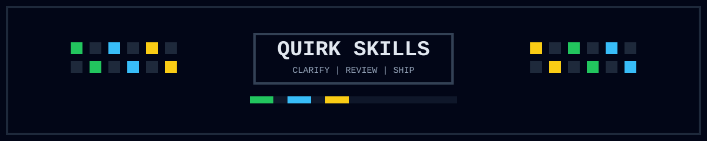
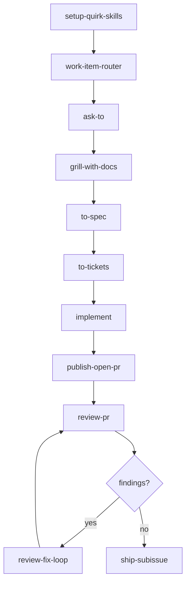
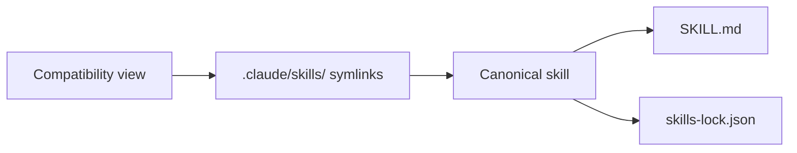

<p align="center">
  
  
  
</p>

# quirk Skills

<p align="center">
  
</p>

<p align="center">
  
  
  
</p>

`quirk Skills` is a repository-local workflow system for moving software work from intent to validated delivery.

It follows the `quirk` method: clarify before building, preserve context, split work into claimable slices, review against separate Standards and Spec axes, repair with explicit plans, and ship only on clean evidence.

If a PR branch is conflicted, resolve branch state first with `resolving-merge-conflicts`, then return to `review-pr` and `review-fix-loop` before shipping.

[Quick Start](#quick-start) · [Flow](#core-flow) · [Architecture](#architecture) · [Docs](#documentation) · [Quality](#quality--validation) · [Install](#installation--sync) · [Contribute](#contributing) · [License](#license)

<a id="quick-start"></a>

## 🚀 Quick Start

```bash
git clone https://github.com/quantumquirkxyz/skills-quirk.git
cd skills-quirk
# Node.js 18+ and Bash are required; CI uses Node.js 20.
node .agents/skills/platform/check-all.mjs
```

Run commands from the repository root. The core validation tools use Node.js built-ins and do not require `npm install`. A successful validation prints `status: "pass"`; resolve reported failures before treating the bundle as ready.

Install the bundle into another repository with a dry run first:

```bash
# Existing repository-safe preview: reports conflicts and writes nothing.
node .agents/skills/platform/sync-bundle.mjs /path/to/target-repo

# Apply only after reviewing the dry run.
node .agents/skills/platform/sync-bundle.mjs /path/to/target-repo --write
```

For a brand-new target where replacing starter docs is acceptable, use `scripts/install-quirk-skills.sh`. For any repository that already has a `README.md`, `CONTEXT.md`, ADRs, or local docs, prefer the dry-run sync plus the existing-repository prompt in [Installation & Sync](#installation--sync).

Follow the [adoption guide](docs/how-to/adoption.md) to configure local context, then invoke `ask-to` or the relevant skill through your coding agent. Skill names describe agent instructions, not shell commands.

<details>
<summary>What the bundle includes</summary>

- **Setup automation** — `scripts/setup-quirk-skills.sh` to install in target repos
- **Canonical auxiliary skills** — `.agents/skills/auxiliary/integration-playground`, `.agents/skills/skill-dev/skill-testing-framework`, and foundation skills: `agent-canvas`, `context-engine`, `mcp-server`, `subagent-swarm`
- **CI validation** — `.github/workflows/validate.yml`
- **Skill evolution** — `skill-lab.mjs` and `skill-evolver.mjs`
- **Skills manifest** — `skills.json` for portable bundle definition and `npx skills` compatibility
- **Work-item routing** — `work-item-router.mjs` for keyword-based skill selection

</details>

## Table of Contents

- [About](#about)
- [Core Flow](#core-flow)
- [Architecture](#architecture)
- [Method](#method)
- [Documentation](#documentation)
- [Quality & Validation](#quality--validation)
- [Distribution](#distribution)
- [Installation & Sync](#installation--sync)
- [Governance](#governance)
- [Contributing](#contributing)
- [License](#license)

<a id="about"></a>

## About

> A portable skills stack for standard project development. Install it into a repository, then specialize it through that repo's own `CONTEXT.md`, ADRs, issue tracker configuration, validation commands, and stack-specific skills.

| Location | Role |
|---|---|
| `.agents/skills/` | Canonical skill definitions (`SKILL.md`) |
| `.claude/skills/` | Generated compatibility view (committed symlinks) |
| `skills-lock.json` | SHA-256 integrity hashes for canonical skills |
| `CONTEXT.md` | Repository-local vocabulary |
| `docs/reference/agents/` | Work-item, routing, issue-tracker, and provenance reference |

---

<a id="core-flow"></a>

## Core Flow



### Standard Feature Flow

| Stage | Skills | Result |
|---|---|---|
| Clarify | `ask-to`, `grill-with-docs` | Agreed scope and durable context |
| Plan | `to-spec`, `to-tickets` | Specification and claimable work items |
| Build | `implement`, `publish-open-pr` | Validated change and pull request |
| Review | `review-pr`, `review-fix-loop` | Findings resolved with evidence |
| Deliver | `ship-subissue` | Delivery after the review gate |

---

<a id="architecture"></a>

## Architecture



<details>
<summary>Skill layer</summary>

- `.agents/skills/` — canonical skills with `SKILL.md` and integrity hashes
- `.claude/skills/` — generated compatibility symlinks, committed intentionally for Claude-style consumers and regenerated by bundle tooling rather than hand-edited
- `skills-lock.json` — integrity hashes

</details>

<details>
<summary>Method layer</summary>

- `CONTEXT.md` — local vocabulary and conventions
- `docs/reference/agents/` — work-item, issue-tracker, provenance, routing, and skill-template reference
- `docs/how-to/` — adoption, installation, release, and workflow guidance

</details>

<details>
<summary>Execution layer</summary>

- Validation scripts: `.agents/skills/platform/check-all.mjs`
- Bundle synchronization script: `.agents/skills/platform/sync-bundle.mjs`
- Router: `work-item-router.mjs`

</details>

<details>
<summary>Quality layer</summary>

- **Quality scoring** — `quality-scorer.mjs`
- **Security scanner** — `security-scanner.mjs`
- **Dependency graph** — `dependency-graph.mjs`
- **Evaluation fixtures** — `evaluate-fixtures.mjs`

</details>

<details>
<summary>Registry & distribution layer</summary>

- **Registry** — `registry.yaml`
- **Marketplace** — `.claude-plugin/marketplace.json`
- **Catalog** — `CATALOG.md`
- **LLMS** — `llms.txt`
- **Plugins** — `plugins/fullstack/`, `plugins/devops/`, `plugins/ai-ml/`

</details>

<details>
<summary>Runtime layer</summary>

- **MCP server** — `mcp-server/mcp-skills-server.mjs`
- **OTEL instrumentation** — `otel-skill-instrumentation.mjs`
- **Execution analytics** — `record-execution.mjs`

</details>

<details>
<summary>Governance layer</summary>

- **Evidence-gated updates** — `skill-evolver.mjs`
- **Audit trail** — `audit-trail.mjs`
- **Versioning** — dist-tags `stable` / `beta` / `canary`
- **Standards compliance** — `agentskills-compliance.mjs` (agentskills.io spec + progressive disclosure budgets)
- **Self-improvement** — `trace-improver.mjs` (trace-driven proposals), `trajectory-eval.mjs` (state-machine conformance)
- **Benchmark** — `benchmark-harness.mjs` (pass@k, duration stats, history)
- **Trust registry** — `trust-registry.mjs` (pre-install scoring for third-party skills)
- **Marketplace export** — `marketplace-export.mjs` (standard agentskills.io export for community registries)

</details>

<details>
<summary>Platform layer</summary>

- **NPX CLI** — `bin/skills-quirk.js`
- **Discovery site** — `site/`
- **Plugin system** — `.claude-plugin/plugin.json`
- **Runtime hooks** — `hooks/hooks.json` (tool-risk PreToolUse guard, session-context)
- **Subagents** — `.claude/agents/` (architect, explorer, reviewer, tester, implementer, doc-writer)
- **Native agent views** — `.cursor/`, `.gemini/`, `.github/`, `.opencode/`, `.windsurf/` skill views

</details>

---

<a id="method"></a>

## Method

> [!NOTE]
> The full method vocabulary and quality bar are documented at [docs/explanation/quirk-method.md](docs/explanation/quirk-method.md).

| Principle | Rule |
|---|---|
| Context before action | Build a fresh context pack before broad work |
| Questions before commitments | Use `grill` or `grill-with-docs` when work is ambiguous |
| Artifacts over vibes | Specs, tickets, PR bodies, review plans must be durable |
| Vertical slices | Tickets should be narrow, complete paths |
| Measurement before repair | Review Standards and Spec separately |
| Branch-state before repair | Resolve conflicts first, then review |
| Repo-local specialization | Each project owns its domain language and risk boundaries |
| Fail closed on uncertainty | Missing fixed points must be surfaced |

---

<a id="documentation"></a>

## Documentation

> [!NOTE]
> For installation and sync, start with [docs/how-to/adoption.md](docs/how-to/adoption.md).

| Document | Purpose |
|---|---|
| [AUTHORSHIP.md](AUTHORSHIP.md) | Authorship and integrity |
| [quirk method](docs/explanation/quirk-method.md) | Method vocabulary and quality bar |
| [provenance](docs/explanation/provenance.md) | Origin and redesign status |
| [adoption guide](docs/how-to/adoption.md) | Installation and sync |
| [skill templates](docs/reference/agents/skill-templates.md) | Artifact templates map |
| [stack matrix](docs/reference/agents/stack-matrix.md) | Stack-specific skills |
| [skill style guide](docs/how-to/skill-style.md) | Editing and authoring rules |
| [Skill Lab toolkit](docs/how-to/skill-lab.md) | Skill lab reference |
| [release checklist](docs/how-to/release.md) | Pre/post-release gates |
| [multi-agent protocol](docs/reference/agents/multi-agent-protocol.md) | Multi-session handoff rules |
| [skill inventory](docs/reference/agents/skill-inventory.md) | Generated per-skill status table |

---

<a id="quality--validation"></a>

## Quality & Validation

> Run the local gate from the repo root. A successful run reports `status: "pass"`; badges are descriptive and do not prove a passing gate.

```bash
node .agents/skills/platform/check-all.mjs
```

> [!TIP]
> The full gate covers structure, semantic health, scenario fixtures, behavioral fixtures, syntax checks, shell template checks, and platform tests.

### Current validation posture

The full gate is expected to pass before the bundle is treated as ready. At release time, `check-all.mjs` should report `failed: 0`, `totalWarnings: 0`, and `totalErrors: 0`. Run the gate locally rather than relying on badges or version strings.

### Quality scoring

```bash
node .agents/skills/platform/quality-scorer.mjs .agents/skills/skill-dev/skill-creator
```

Scores each skill 0-100 across 6 dimensions. Returns grade A-F and tier BASIC/STANDARD/POWERFUL.

### Security scan

```bash
node .agents/skills/platform/security-scanner.mjs .agents/skills/skill-dev/skill-creator
```

Detects credential leakage, command injection, prompt injection, missing approval gates, and typosquatting risks. Returns blocked / review-required / pass.

### Dependency graph

```bash
node .agents/skills/platform/dependency-graph.mjs --format mermaid
node .agents/skills/platform/dependency-graph.mjs --format json
```

Produces a dependency graph, reports cycles, and identifies central skills. The graph is a DAG only when it contains no cycles.

### Fixtures

```bash
node .agents/skills/platform/evaluate-fixtures.mjs --threshold 0.8
```

Runs behavioral, regression, and security fixtures with configurable pass threshold.

---

<a id="distribution"></a>

## Distribution

### Local CLI and platform scripts

The CLI resolves scripts relative to the current working directory, so use it from this checkout. Several commands currently have dispatch limitations: `list`, `search`, and `metrics` combine a script path with a subcommand, while `score` and `security` require a skill directory rather than a bare skill name. Use the direct scripts for these operations:

```bash
node bin/skills-quirk.js help
node .agents/skills/platform/skill-lab.mjs list
node .agents/skills/platform/skill-lab.mjs search "react testing"
node .agents/skills/platform/quality-scorer.mjs .agents/skills/skill-dev/skill-creator
node .agents/skills/platform/security-scanner.mjs .agents/skills/delivery/implement
node scripts/sync-registry.mjs
node scripts/sync-registry.mjs --write
```

`package.json` names the package `skills-quirk`. Package publication and npm release channels must be verified separately; the source checkout is the reproducible entry point documented here.

### Registry and marketplace

- `registry.yaml` — bundle metadata; schema defined in `schema/registry.schema.json`
- `.claude-plugin/marketplace.json` — generated Claude Code marketplace manifest
- `CATALOG.md` — auto-generated skill catalog
- `llms.txt` — agent-discovery entrypoint
- `plugins/` — namespace plugin bundles

### MCP server

```bash
node .agents/skills/platform/mcp-server/mcp-skills-server.mjs --stdio
```

Exposes skills as MCP tools: `list_skills`, `get_skill`, `search_skills`, `resolve_skill_for_task`, `validate_skill`, `score_skill`.

### Bundle sync

This copies bundle files into another repository. It is separate from `scripts/sync-registry.mjs`, which regenerates discovery artifacts in this repository. Bundle sync also includes `README.md`, `CONTEXT.md`, and documentation; existing differing files block the operation unless `--force` is supplied. Review the dry run and preserve target-local documentation before applying changes. Use the existing-repository prompt below for a skills-only update.

<details>
<summary>Dry-run sync</summary>

```bash
node .agents/skills/platform/sync-bundle.mjs /path/to/target-repo
```

</details>

<details>
<summary>Apply sync</summary>

```bash
node .agents/skills/platform/sync-bundle.mjs /path/to/target-repo --write
```

</details>

---

<a id="installation--sync"></a>

## Installation & Sync

The bundle is designed to be copied into another repository and specialized there. Use the path that matches the target repository's state.

### Recommended path: safe sync into any repository

Use `sync-bundle.mjs` from a local checkout. The first command is a dry run: it reports files and conflicts but writes nothing.

```bash
git clone https://github.com/quantumquirkxyz/skills-quirk.git
cd skills-quirk
node .agents/skills/platform/check-all.mjs
node .agents/skills/platform/sync-bundle.mjs /path/to/target-repo
node .agents/skills/platform/sync-bundle.mjs /path/to/target-repo --write
```

If the dry run reports conflicts, inspect them before using `--force`. Existing repositories should usually preserve their own `README.md`, `CONTEXT.md`, ADRs, and product documentation; sync only the skills bundle paths unless the user explicitly approves broader adoption changes.

### Greenfield path: replace starter docs

Use the shell installer only for a new or disposable target where replacing bundle-managed paths is acceptable:

```bash
git clone https://github.com/quantumquirkxyz/skills-quirk.git
bash skills-quirk/scripts/install-quirk-skills.sh /path/to/new-target-repo /path/to/skills-quirk
```

The installer copies `.agents/skills/`, `.claude/skills/`, `docs/reference/agents/`, `docs/reference/adr/README.md`, `docs/how-to/`, `docs/explanation/`, `AUTHORSHIP.md`, `CONTEXT.md`, `skills-lock.json`, `skills.json`, and `.env.template`. It replaces those target paths when they already exist.

### What gets installed

| Path | Purpose |
|---|---|
| `.agents/skills/` | Canonical skills with `SKILL.md` entrypoints |
| `.claude/skills/` | Generated compatibility symlinks for Claude-style consumers |
| `skills-lock.json` | SHA-256 hashes for canonical skills |
| `docs/reference/agents/` | Work-item, routing, issue-tracker, and provenance reference |
| `docs/how-to/` | Adoption, installation, release, and workflow guides |
| `docs/explanation/` | quirk Method and provenance explanations |
| `CONTEXT.md` | Repository-local vocabulary to specialize after install |
| `AUTHORSHIP.md` | Authorship and integrity rules |

### Validate in the target repository

After syncing, run from the target root:

```bash
node .agents/skills/platform/check-all.mjs
```

Expected summary: `failed: 0`, `totalWarnings: 0`, `totalErrors: 0`.

```text
[ PROMPTS ] AI-AGNOSTIC PROMPTS
```

Use one of these prompts when you want an AI-agnostic IDE to install or sync this skills bundle into another repository.

> [!IMPORTANT]
> These prompts are preserved verbatim. Use them as-is when installing or syncing.

### 1. Greenfield repository, no prior context

```text
You are going to install the quirk Skills bundle into this repository from scratch.

REPO_UPSTREAM = <url of the canonical skills repo>  # for example, https://github.com/quantumquirkxyz/skills-quirk

## Objective
Bring this repository into a valid quirk Skills state with the canonical bundle installed, local context documented, and the repo ready for normal work.

## What you must not touch
- Any existing ADRs or files under `docs/reference/adr/`
- Any repository documentation that is already established and unrelated to the bundle bootstrap
- Anything that is not needed to install, configure, or validate the skills bundle

## Allowed scope
1. `.agents/AGENTS.md`
2. `.agents/skills/**`
3. `.claude/skills/**`
4. `skills-lock.json`
5. `skills.json`
6. `CONTEXT.md`
7. `README.md` only if needed to add a short install or usage entry point
8. `docs/reference/agents/**`, `docs/reference/adr/README.md`, `docs/how-to/**`, and `docs/explanation/**` only if the repository does not already have the quirk documentation surface and it must be created as part of the bootstrap

## Steps
1. Clone the upstream into a temporary directory with `git clone --depth 1 <REPO_UPSTREAM> <temp-dir>`.
2. Verify that the upstream contains `.agents/skills/**`, `.claude/skills/**`, `skills-lock.json`, and the expected docs surface under `docs/reference/agents/`, `docs/how-to/`, and `docs/explanation/`.
3. Run the upstream dry run: `node .agents/skills/platform/sync-bundle.mjs <target-repo>`.
4. Compare the local repo with the upstream bundle and identify any missing skills, renamed skills, conflicts, or local-only additions.
5. Copy the canonical bundle into the local repo, preserving symlinks and lockfile hashes.
6. Create or update `CONTEXT.md` so it describes only this repository's local vocabulary and setup.
7. Update `README.md` only if it needs a short installation or usage entry point for the new repository.
8. Run `node .agents/skills/platform/check-all.mjs` and confirm the working tree is clean for the intended scope.

## Final checks
- `git status` must show only the expected bundle files and the local context/docs files you intentionally changed.
- No ADR file under `docs/reference/adr/` should be modified unless the user explicitly requested it.
- The result should be a repository that can be used by an AI-agnostic IDE without extra hidden setup.
```

### 2. Existing repository with ADRs and local context

```text
You are going to synchronize the quirk Skills bundle in this repository with the canonical upstream.

REPO_UPSTREAM = <url of the canonical skills repo>  # for example, https://github.com/quantumquirkxyz/skills-quirk

## Objective
Update the skills implementation so it matches the upstream bundle while preserving the repository's own documentation, ADRs, and local context.

## What you must not touch
- `docs/adr/**`, `docs/reference/adr/**`, and any ADR content
- `CONTEXT.md`
- `README.md`
- Any repository documentation outside the skills bundle scope
- Any project files unrelated to the skills bundle

## Allowed scope
1. `.agents/AGENTS.md` if the upstream bundle includes it and it differs
2. `.agents/skills/**`
3. `.claude/skills/**`
4. `skills-lock.json`
5. `skills.json` if present in the target or needed by the local agent tooling

## Steps
1. Clone the upstream into a temporary directory with `git clone --depth 1 <REPO_UPSTREAM> <temp-dir>`.
2. Run `node .agents/skills/platform/sync-bundle.mjs <target-repo>` from the upstream checkout and inspect the dry-run report before editing anything.
3. Replace only the canonical skills tree, compatibility view, lockfile, and explicitly allowed bundle metadata with the upstream versions, preserving symlinks.
4. Do not rewrite repository docs, ADRs, README, or CONTEXT.md to make the sync fit; keep the bundle change narrowly scoped to the skills bundle.
5. Validate the sync and confirm that only the allowed paths changed.

## Final checks
- `git status --short` must show only `.agents/AGENTS.md`, `.agents/skills/`, `.claude/skills/`, `skills-lock.json`, `skills.json`, and any explicitly allowed optional file.
- ADRs, `CONTEXT.md`, `README.md`, and product documentation must remain untouched.
- If any protected path changes, revert only that part before finishing.
```

<details>
<summary>After installation</summary>

1. Specialize `CONTEXT.md` for the target repository.
2. Follow the [adoption guide](docs/how-to/adoption.md) to set the issue tracker, domain docs, and validation commands.
3. Run `node .agents/skills/platform/check-all.mjs` from the target root.
4. Use `ask-to` or the standard flow to route work.

</details>

---

<a id="governance"></a>

## Governance

> [!NOTE]
> Evidence-gated updates require specific evidence types depending on the change category.

### Versioning

Channel names in registry metadata do not establish that npm dist-tags have been published.

The current version is recorded in [VERSION](VERSION). Release changes are recorded in [CHANGELOG.md](CHANGELOG.md).

### Evidence-gated updates

```bash
node .agents/skills/platform/skill-evolver.mjs .agents/skills/skill-dev/skill-creator --target-version=2 --dry-run --evidence=quality-score
node .agents/skills/platform/skill-evolver.mjs .agents/skills/skill-dev/skill-creator --dry-run --evidence=quality-score,security-scan
```

| Change category | Required evidence |
|---|---|
| `metadata` | quality-score |
| `operational-spec` | behavioral-fixture + quality-score |
| `behavioral-constraint` | behavioral-fixture + security-scan |
| `knowledge` | quality-score |
| `compatibility` | dependency-check + regression-test |

### Audit trail

```bash
node .agents/skills/platform/audit-trail.mjs record evolution-approved --skill skill-creator --detail '{"version":"1->2"}'
node .agents/skills/platform/audit-trail.mjs query --skill skill-creator
node .agents/skills/platform/audit-trail.mjs stats
```

JSONL append-only log of skill lifecycle events in `.agents/skills/platform/audit/`.

---

<a id="contributing"></a>

## Contributing

See [CONTRIBUTING.md](CONTRIBUTING.md) for the full development workflow.

Quick checklist before submitting:

1. Run `node .agents/skills/platform/check-all.mjs`
2. Verify `node .agents/skills/platform/validate-skills.mjs`
3. Check `node .agents/skills/platform/audit-semantics.mjs`
4. Confirm `node .agents/skills/platform/evaluate-scenarios.mjs`

> [!IMPORTANT]
> Follow [docs/how-to/skill-style.md](docs/how-to/skill-style.md) when editing or authoring skills.

Questions? Check `docs/reference/agents/` and `docs/how-to/` for more documentation.

## License

MIT License — see [LICENSE](LICENSE) for details.

## Authorship

Copyright (c) 2026 Jhuomar Boskoll Quintero.

The project is MIT licensed. See [LICENSE](LICENSE).

[Back to top](#)
