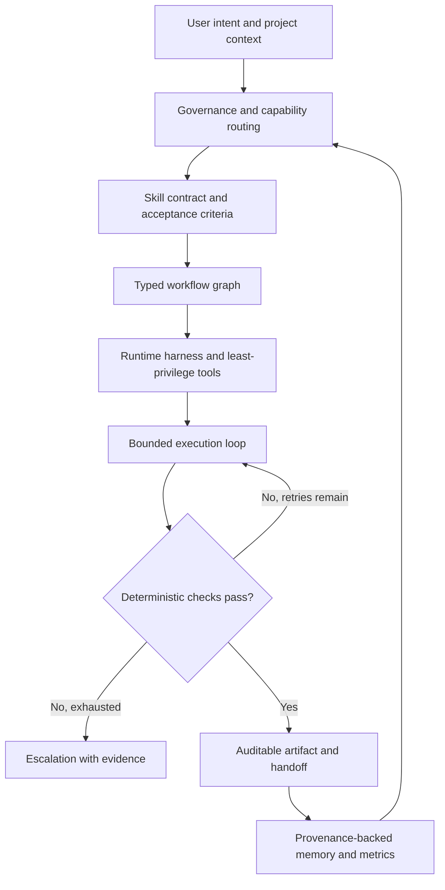

# Agent Engineering Methodologies: A Systems View (2026)

Status: technical research and design guidance; not an implemented capability. Reviewed 2026-10-26.

## Purpose and scope

Quirk Skills should remain a portable, domain-agnostic bundle of composable Agent Skills with deterministic guardrails and explicit interfaces. The objective is **not** to require every consuming project to adopt one framework, language, model, cloud platform, vector database, or issue tracker. Specialization belongs to project-level context, architecture decision records (ADRs), adapters, and optional capabilities.

Terms such as *loop engineering*, *graph engineering*, and *memory engineering* are useful architectural labels, but are not universally standardized software engineering disciplines. Evaluate their mechanisms, not their popularity. Standard software engineering still governs: separation of concerns, contracts, state machines, dependency management, least privilege, verification, observability, maintainability, and reversible changes.

## Methodology map

| Layer | Engineering concern | Quirk integration opportunity | Verification |
|---|---|---|---|
| Prompt and rule engineering | Precise instructions, boundaries, and instruction precedence | Portable descriptions, `AGENTS.md`, scoped guardrails | Negative/injection and instruction-conflict tests |
| Context engineering | Retrieval, just-in-time loading, relevance, compaction and budgets | `context-pack`, context-budget auditor | Recall of critical decisions; measured context usage |
| Memory engineering | Persisted semantic, episodic and procedural state | Memory index, ADRs, auditable handoffs | Provenance, freshness, TTL, deletion, replay tests |
| Harness engineering | Tools, sandboxes, filesystem, identity, validation and runtime | Existing platform scripts, fixtures and side-effect audits | Full gates, tool permissions, isolation, exit codes |
| Loop engineering | Iterative plan–act–observe–verify cycles | Existing loop runner, review-fix loop | Max iterations, stop conditions, monotonic evidence |
| Graph engineering | Typed dependencies, DAG planning, fan-out/fan-in, workflows | Skill graph, work-item router, ticket DAG | Cycle detection, deterministic state transitions |
| Evaluation engineering | Offline/online scenarios and release decisions | Routing and behavioral evals, fixture suites | False triggers, task success, regression delta, cost |
| Security engineering | Trust boundaries, prompt injection, supply chain and permissions | Skill risk tiers, security scanners | Unauthorized side effects must fail closed |
| Observability engineering | Traces, logs, metrics, audit events and causality | Metrics, audit-trail, traceability | Correlatable IDs; error, latency and retry metrics |
| Protocol engineering | Cross-tool and cross-agent interoperability | Existing MCP support; potential A2A adapter | Versioned schema and interoperability tests |
| Reliability engineering | Recovery, retries, idempotency, durable checkpoints | State-machine replay and idempotency harness | Crash/resume, duplicate actions, timeouts |
| Platform engineering | Self-service installation and reusable golden paths | CLI, sync bundle, native agent projections | Install/update/uninstall smoke tests in clean targets |

## A composable architecture

This is a conceptual architecture, not a claim that every edge already exists in the implementation. Treat **skill** as a declarative capability; **rule** as a constraint; **harness** as the execution boundary; **loop** as temporal control; **graph** as dependencies/state; **memory** as persisted evidence; and **evaluation** as the promotion gate. Keep these concerns independently testable.

## Critical design rules

### Harness and least privilege

- Scope file, command, network, credential, issue tracker, PR, and deployment access separately.
- Treat repository text, tool results, web pages, and MCP responses as untrusted instructions.
- Require explicit approval before remote writes, merges, deployments, destructive changes, or widened tool scope.
- Keep sandbox isolation, deterministic tests and an inspectable execution log independent of model output.

### Loops and graphs

- Each loop defines explicit preconditions, bounded retries, timeout, progress measure, error classification and stop condition.
- Re-trying a side-effecting operation requires idempotency keys or deduplication; otherwise escalate.
- Only parallelize independent graph nodes with isolated workspaces and deterministic merge/convergence rules.
- Keep human approval nodes first-class; never bypass approval by switching from sequential to parallel execution.

### Context and memory

- Separate transient prompt context from durable repository decisions and execution checkpoints.
- Store source, timestamp, trust tier, relevance, freshness and deletion policy for durable memories.
- Prefer selective retrieval over eagerly injecting all skill bodies into every request.
- Evaluate compaction for preservation of obligations, design decisions and unclosed defects.
- Do not persist credentials, personal data, or unverified assertions as trusted memory.

### Evaluation and observability

- Establish a baseline before changing routing or skill contracts; distinguish **NOT RUN** from **PASS**.
- Verify correct output, correct non-action, latency/cost, security behavior and replayability.
- Use representative tasks, clean environments and hidden negative tests; beware benchmark leakage and flawed ground-truth oracles.
- Correlate trace, task, attempt, skill and artifact identifiers; redact sensitive data by default.
- OpenTelemetry GenAI conventions remain evolving; use an adapter rather than treating draft fields as immutable storage schema.

## Portable adoption tiers

1. **Minimal:** individual Agent Skills installed selectively; no bundled runtime assumed.
2. **Managed:** project-specific `CONTEXT.md`, ADRs, governance index, validation and optional native views.
3. **Full harness:** checked-out bundle tooling, evaluation fixtures, state-machine replay and security gates.
4. **Distributed:** optional MCP/A2A integrations with separately approved identities, network boundaries and orchestration.

Do not claim a minimal selective install provides full managed-harness behavior: installer modes intentionally differ in artifacts and responsibilities.

## Evaluation gates for promoting a proposed method

A proposal must specify target users; failure mode; existing overlapping features; performance/security hypothesis; deterministic fixtures; permissions and data retention; fallback; compatibility; rollback; and versioned migration plan. Adopt a new runtime dependency only when experiments show net value over the existing local mechanism. A new skill is justified by durable unique behavior, not a new label for an existing skill.

## Primary sources

- [OpenAI, Harness engineering (Feb 2026)](https://openai.com/index/harness-engineering/)
- [IEEE, Harness Engineering for AI Coding Agents (2026)](https://ieeexplore.ieee.org/document/11634633/)
- [Anthropic, Effective context engineering](https://www.anthropic.com/research/effective-context-engineering-for-ai-agents)
- [Anthropic, Memory, compaction and tool clearing (Mar 2026)](https://platform.claude.com/cookbook/tool-use-context-engineering-context-engineering-tools)
- [LangChain, Runtime behind production deep agents (Apr 2026)](https://www.langchain.com/blog/runtime-behind-production-deep-agents)
- [Microsoft, Multi-agent patterns](https://learn.microsoft.com/en-us/agents/architecture/multi-agent-patterns)
- [A2A protocol](https://a2a-protocol.org/latest/)
- [OpenTelemetry GenAI semantic conventions](https://github.com/open-telemetry/semantic-conventions-genai/blob/main/docs/gen-ai/gen-ai-agent-spans.md)
- [SWE-bench Pro V2 evaluation protocol (Sep 2026)](https://labs.scale.com/leaderboard/swe_bench_pro_public_v2?tab=full)
- [Agent Skills CLI](https://www.skills.sh/docs/cli)

## Related repository documents

- [Engineering evolution roadmap](../reference/agents/engineering-evolution-2026.md)
- [Skill conflict matrix](../reference/agents/conflict-matrix.md)
- [Adoption guide](../how-to/adoption.md)
- [Skill style guide](../how-to/skill-style.md)
