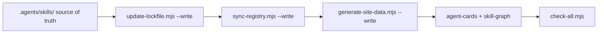

# Regenerating the Bundle Views

Use this guide when a generated file in this repository disagrees with the skills bundle, when a compatibility symlink breaks, or after any structural change to `.agents/skills/`.



## What a generated view is

`.agents/skills/` is the only source of truth for skill content. Every other listing of skills in this repository is a **generated view**: a projection derived from the canonical `SKILL.md` files, their frontmatter, and `registry.yaml`.

Views exist because each consumer needs a different shape of the same data — a flat symlink directory for Claude Code, a Markdown catalog for humans, a JSON index for the site. The content is identical; the projection is not.

Two counts make the contract checkable:

| Count | Meaning |
|---|---|
| 254 | bundle skills, excluding `.agents/skills/platform/**` infrastructure |
| 266 | repo skills, the 254 above plus platform infrastructure |

`tests/projection-consistency.test.mjs` pins the bundle count across every projection, so a hand-edited view fails the gate instead of shipping.

## The rule: regenerate, never hand-edit

- Never edit a generated artifact directly. The next regeneration silently deletes your change.
- If a view is wrong, the source is wrong: fix the `SKILL.md` frontmatter or `registry.yaml`, then regenerate.
- The compatibility view is the one view no generator repairs, so it has a dedicated repair script (see below).
- Dry-run first. Every generator except the Agent Cards corpus and the skill graph defaults to reporting what it would write.

## Generated artifacts

| Artifact | Path | Generated by | Command | Dry-run by default | When it drifts |
|---|---|---|---|---|---|
| Lockfile hashes | `skills-lock.json` | `.agents/skills/skill-dev/lockfile-maintenance/scripts/update-lockfile.mjs` | `node .agents/skills/skill-dev/lockfile-maintenance/scripts/update-lockfile.mjs --write` | Yes | A `SKILL.md` changed; re-lock, never edit hashes |
| Compatibility view | `.claude/skills/` | `scripts/sync-registry.mjs` (creates missing links only) | `node scripts/sync-registry.mjs --write` | Yes | See *Repair the compatibility view* |
| Native local views | `.cursor/skills/`, `.gemini/skills/`, `.github/skills/`, `.opencode/skills/`, `.windsurf/skills/` | `.agents/skills/platform/project-agent-paths.mjs` | `node .agents/skills/platform/project-agent-paths.mjs --write` | Yes; absent views are clean | Delete and regenerate; never commit |
| Catalog | `CATALOG.md` | `scripts/sync-registry.mjs` | `node scripts/sync-registry.mjs --write` | Yes | Re-run with `--write` |
| Discovery entrypoint | `llms.txt` | `scripts/sync-registry.mjs` | `node scripts/sync-registry.mjs --write` | Yes | Re-run with `--write` |
| Marketplace manifest | `.claude-plugin/marketplace.json` | `scripts/sync-registry.mjs` | `node scripts/sync-registry.mjs --write` | Yes | Re-run with `--write` |
| Site data | `site/src/skills.json` | `scripts/generate-site-data.mjs` | `node scripts/generate-site-data.mjs --write` | Yes | Re-run with `--write` |
| Agent Cards corpus | `.agents/skills/platform/agent-cards/*.json` | `.agents/skills/platform/scripts/generate-agent-cards.mjs` | `node .agents/skills/platform/scripts/generate-agent-cards.mjs` | **No** — writes and prunes in place; pass `--out <dir>` for a scratch copy, `--no-prune` to keep extra cards | Re-run with no flags |
| Skill graph | `.agents/skills/platform/graph/skill-graph.json` | `.agents/skills/platform/skill-graph.mjs` | `node .agents/skills/platform/skill-graph.mjs build` | **No** — writes in place | Re-run `build` |
| Runtime manifests | `.agents/skills/platform/manifests/<skill>.runtime.json` | `.agents/skills/platform/scripts/build-runtime-manifests.mjs` | `node .agents/skills/platform/scripts/build-runtime-manifests.mjs --write` | Yes | Re-run with `--write`; add `--skill <domain/skill>` to scope one skill |

`scripts/sync-registry.mjs` produces four of these projections in one pass, so a single `--write` run keeps the catalog, the discovery entrypoint, the marketplace manifest, and the missing compatibility symlinks in agreement.

Native local views are deliberately different from the committed compatibility
view. They are ignored, generated only when a local consumer needs its native
path, and safe to remove. Generate all five or select one:

```bash
node .agents/skills/platform/project-agent-paths.mjs --write
node .agents/skills/platform/project-agent-paths.mjs --write --view opencode
```

The package shortcut for all five views is `npm run views:native`. Pass a
single target with `npm run views:native -- --view opencode`.

The runtime manifests are the newest projection. They are generated by a dedicated script and validated by their own test, but they are not yet wired into `check-all.mjs`; until they are, refresh them in the same pass and let the gate catch any disagreement.

## Repair the compatibility view

`scripts/sync-registry.mjs` only *creates* the symlinks that are missing. Two defects therefore survive it:

- **Absolute symlinks** — links committed from another checkout. They resolve on the machine that authored them and break in a clone under a different home directory.
- **Dangling symlinks** — links left behind by a domain that was renamed, merged, or removed.

Repair both with the dedicated tool:

```bash
# dry-run: report what the view needs, change nothing
node .agents/skills/platform/fix-compatibility-view.mjs

# machine-readable report
node .agents/skills/platform/fix-compatibility-view.mjs --json

# apply the repairs
node .agents/skills/platform/fix-compatibility-view.mjs --write
```

An absolute link whose destination exists inside the repository is rewritten as a relative link to that same destination. A link whose destination does not exist, or exists outside the repository, is removed. Links that are already relative and resolve are left untouched. The tool is idempotent: a second run finds nothing to do and reports `status: "clean"` with no pending actions.

Why the dedicated tool instead of a shell loop: rewriting a symlink is a destructive act on a committed view, so it belongs to a reviewed script that reports what it did, refuses to touch anything outside the view, and can be re-run safely. Never hand-edit `.claude/skills/` (see `.agents/AGENTS.md`).

## The correct order after a structural change

Run the generators in this order after adding, renaming, or retiring a skill, and after any change to `registry.yaml`:

```bash
node .agents/skills/skill-dev/lockfile-maintenance/scripts/update-lockfile.mjs --write
node scripts/sync-registry.mjs --write
node scripts/generate-site-data.mjs --write
node .agents/skills/platform/check-all.mjs
```

Each step exists because the next one depends on it:

1. **Lockfile first.** `validate-skills.mjs` fails on a stale hash, and it runs inside the gate, so re-lock before anything else reads the bundle.
2. **Registry projections next.** `sync-registry.mjs` refreshes the catalog, `llms.txt`, the marketplace manifest, and the missing compatibility symlinks from the same pass.
3. **Site data after that.** It projects the same bundle for the site, so it must run against the state the previous step left behind.
4. **Gate last.** `check-all.mjs` validates skills, traceability, semantics, fixtures, the security scan, routing, and the root and platform test suites.

Refresh the two write-in-place views in the same pass, before the gate, so their artifacts and the gate agree:

```bash
node .agents/skills/platform/scripts/generate-agent-cards.mjs
node .agents/skills/platform/skill-graph.mjs build
```

## Verify the regeneration

```bash
node .agents/skills/platform/fix-compatibility-view.mjs --json
node .agents/skills/skill-dev/lockfile-maintenance/scripts/update-lockfile.mjs
node scripts/sync-registry.mjs
node --test tests/*.test.mjs
node .agents/skills/platform/check-all.mjs
```

Expect: the view repair reports no pending actions, the lockfile reports `clean`, the registry dry-run discovers the expected number of bundle skills and proposes no new symlinks, the tests pass, and the gate reports `status: "pass"`.

## See also

- [Adoption](adoption.md) — install and synchronize the bundle in a target repository
- [Release](release.md) — release checklist and gates
- [Skill Style](skill-style.md) — rules for editing and adding skills
- [Workflows](workflows.md) — workflow overview and navigation
