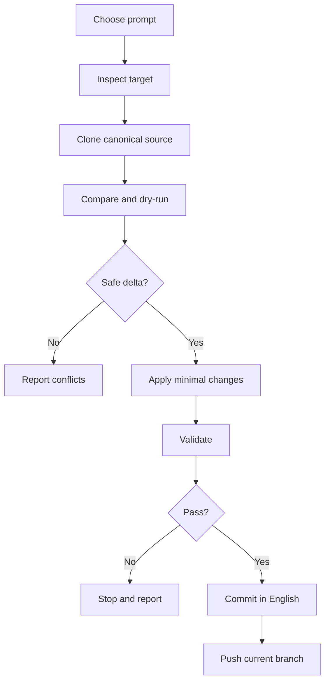

# Installation and Update Prompts

This document contains the canonical, AI-agnostic prompts for adopting the Quirk Skills bundle. They are designed for an AI coding agent operating inside the target repository.

The prompts use Git, Bash, and the Node.js runtime already required by the bundle. They do not use npm, npx, package publication, or a package registry.

## Operating contract

Both prompts follow the same rules:

- Work in English, including generated documentation, commit messages, and push summaries.
- Inspect first and mutate second.
- Use a temporary shallow clone of the canonical repository as the source of truth.
- Run a dry run before applying any bundle change.
- Never use `--force` automatically.
- Never overwrite ADRs, project documentation, `CONTEXT.md`, product code, or local skills unless the prompt explicitly allows that path.
- Preserve existing symlinks when they already point to the correct canonical skill.
- Use SHA-256 content comparison so identical files are not rewritten.
- Commit only the intended files.
- Push only to the repository's current branch and never force-push.
- Stop and report evidence when authentication, protected paths, conflicts, or validation failures block completion.

## Prompt A — First installation into a repository

Use this prompt when the target repository does not have a managed Quirk Skills installation.

```text
You are installing the Quirk Skills bundle into the current repository for the first time.

CANONICAL_REPOSITORY = https://github.com/quantumquirkxyz/skills-quirk.git

Work automatically inside the current repository. Use English for every file you create or modify, every commit message, and every final summary. Do not use npm, npx, package installation, or a registry. Use only git, bash, the existing Node.js runtime, and the scripts shipped by the canonical repository.

Objective:
Install a valid, reproducible Quirk Skills bundle, preserve the target repository's project-specific content, validate the installation, create one English commit, and push it to the current branch when the remote and credentials permit.

Execution contract:
1. Inspect before editing:
   - Run git status --short, git branch --show-current, and git remote -v.
   - Inspect AGENTS.md, CLAUDE.md, CONTEXT.md, docs/, ADR directories, .agents/, and .claude/.
   - Detect whether .agents/skills, .claude/skills, skills-lock.json, or .agents/quirk-install.json already exist.
   - If a managed or partial installation already exists, stop and use the existing-repository update prompt instead of this prompt.
2. Create a temporary directory safely with mktemp -d and clone the canonical repository with:
   git clone --depth 1 https://github.com/quantumquirkxyz/skills-quirk.git <temporary-source>
3. Verify the source contains:
   .agents/skills/
   .claude/skills/
   .agents/skills/platform/sync-bundle.mjs
   skills-lock.json
   skills.json
   docs/how-to/ and docs/explanation/
4. From the canonical checkout, run a dry run against the current repository:
   node <temporary-source>/.agents/skills/platform/sync-bundle.mjs <current-repository>
   Do not write anything if the dry run reports conflicts.
5. If the dry run is clean, apply the installation:
   node <temporary-source>/.agents/skills/platform/sync-bundle.mjs <current-repository> --write
   The installer must preserve symlinks and generate .agents/quirk-install.json.
6. Create or update only the repository-local setup material required by the installation:
   - Keep existing CONTEXT.md and project documentation intact.
   - If CONTEXT.md is absent, create a concise English placeholder that clearly marks repository-specific vocabulary as TODO.
   - Do not create or modify ADR content.
7. Run validation from the target repository root:
   node .agents/skills/platform/validate-skills.mjs
   node .agents/skills/platform/audit-semantics.mjs
   node .agents/skills/platform/fix-compatibility-view.mjs --dry-run
   node .agents/skills/platform/check-all.mjs
   node bin/skills-quirk.js verify-install
   Continue only if the commands pass or report only documented advisory warnings. Record every failure.
8. Review git diff and git status. The changed paths must be limited to the installed bundle, its generated compatibility/integrity metadata, and any intentionally created setup file. Do not stage unrelated changes.
9. Create an English commit:
   chore(skills): install quirk skills bundle
10. Push safely:
   - Push the current branch to its configured upstream if one exists.
   - If no upstream exists, push the current branch with git push -u origin <current-branch>.
   - Never force-push.
   - If push fails because credentials or branch protection are unavailable, keep the commit locally and report the exact command and failure.
11. Remove the temporary source directory and report:
   source revision, changed paths, validation results, commit SHA, push result, and any remaining manual follow-up.

Stop conditions:
- Stop before writing when the dry run reports conflicts.
- Stop before committing when protected project files or unrelated changes appear in the diff.
- Stop before pushing when validation fails or the remote is unavailable.
```

## Prompt B — Incremental update for an existing installation

Use this prompt when the target repository already contains Quirk Skills and must receive newer skills without reinstalling the bundle from scratch.

```text
You are updating an existing Quirk Skills installation in the current repository.

CANONICAL_REPOSITORY = https://github.com/quantumquirkxyz/skills-quirk.git

Work automatically inside the current repository. Use English for every file you create or modify, every commit message, and every final summary. Do not use npm, npx, package installation, or a registry. Use only git, bash, the existing Node.js runtime, and the scripts shipped by the canonical repository.

Objective:
Synchronize only missing or changed canonical skills and their generated compatibility/integrity metadata. Identical files must remain untouched. Preserve local skills, local modifications, project documentation, ADRs, CONTEXT.md, and product code. Create one English commit and push it to the current branch when the remote and credentials permit.

Execution contract:
1. Inspect before editing:
   - Run git status --short, git branch --show-current, and git remote -v.
   - Locate .agents/skills, .claude/skills, skills-lock.json, skills.json, and .agents/quirk-install.json.
   - Record the initial working tree state. Never mix pre-existing user changes into the update commit.
   - If no existing Quirk Skills installation is found, stop and use the first-installation prompt.
2. Create a temporary directory safely with mktemp -d and clone the canonical repository:
   git clone --depth 1 https://github.com/quantumquirkxyz/skills-quirk.git <temporary-source>
3. Build a comparison report before writing:
   - Compare canonical skill paths and SHA-256 hashes from the source skills-lock.json against the target.
   - Classify every skill as identical, missing, outdated, locally modified, locally newer, renamed, or removed upstream.
   - Treat identical files as no-ops. Do not delete and recreate them.
   - Treat locally modified or locally newer skills as conflicts; do not overwrite them automatically.
   - Treat removed upstream skills as review items; do not delete them automatically.
   - Verify every .claude/skills entry is a symlink to the expected .agents/skills target.
4. Run the canonical dry run:
   node <temporary-source>/.agents/skills/platform/sync-bundle.mjs <current-repository>
   Inspect its JSON result. Do not use --force automatically. A conflict involving a local file, local modification, non-symlink compatibility entry, ADR, CONTEXT.md, README.md, or product documentation is a hard stop.
5. Apply only the safe delta:
   node <temporary-source>/.agents/skills/platform/sync-bundle.mjs <current-repository> --write
   The synchronizer must compare file contents and skip byte-identical files. It may create missing files and update changed bundle-managed files only after the dry run confirms they are safe. It must preserve valid existing compatibility symlinks.
6. Reconcile generated metadata only when required:
   - Update skills-lock.json and skills.json when the canonical bundle changed.
   - Update .agents/quirk-install.json to represent the resulting managed state.
   - Do not rewrite metadata when its content is already identical.
7. Run validation from the target repository root:
   node .agents/skills/platform/validate-skills.mjs
   node .agents/skills/platform/audit-semantics.mjs
   node .agents/skills/platform/fix-compatibility-view.mjs --dry-run
   node .agents/skills/platform/check-all.mjs
   node bin/skills-quirk.js verify-install
   Continue only if the commands pass or report only documented advisory warnings. Record every failure.
8. Review the final diff:
   - Only missing/outdated canonical skills, necessary compatibility links, lock/manifests, and explicitly allowed bundle metadata may be changed.
   - Identical skills must not appear in the diff.
   - No ADR, CONTEXT.md, README.md, project documentation, or product code may appear in the diff.
   - Do not stage pre-existing user changes.
9. If the safe delta is empty, report that the installation is already current and do not create an empty commit.
10. If changes exist, create one English commit:
    chore(skills): update quirk skills bundle
11. Push safely:
    - Push the current branch to its configured upstream if one exists.
    - If no upstream exists, push the current branch with git push -u origin <current-branch>.
    - Never force-push.
    - If push fails because credentials or branch protection are unavailable, keep the commit locally and report the exact command and failure.
12. Remove the temporary source directory and report:
    source revision, counts for identical/updated/added/conflicted/removed skills, changed paths, validation results, commit SHA, push result, and manual follow-up.

Stop conditions:
- Stop before writing when the target has uncommitted changes that overlap the bundle paths.
- Stop before overwriting any locally modified or locally newer skill.
- Stop before deleting any upstream-removed skill.
- Stop before committing when protected or unrelated paths appear in the diff.
- Stop before pushing when validation fails or the remote is unavailable.
```

## Recommended lifecycle



The first-installation prompt establishes the bundle. The incremental-update prompt is the default maintenance path afterward. The update prompt is intentionally conservative: an equal skill is a no-op, a local modification is surfaced, and an upstream deletion is reviewed rather than silently removed.
