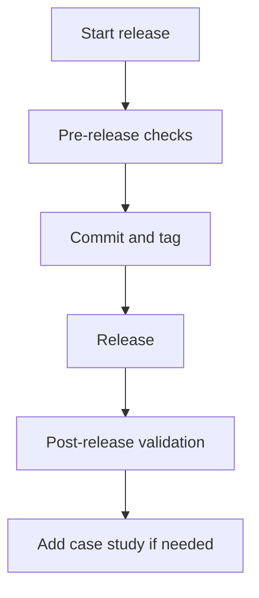

# Release Checklist

Use this checklist before publishing a new quirk Skills version.

## Pre-release

- [ ] Update `VERSION`.
- [ ] Update `CHANGELOG.md`.
- [ ] Update `../explanation/provenance.md` for new, renamed, or retired skills.
- [ ] Update `../reference/agents/skills-map.md` if routing changed.
- [ ] Add or update scenarios for workflow changes.
- [ ] Add or update behavioral fixtures for artifact-template changes.
- [ ] Run `node .agents/skills/platform/check-all.mjs`.
- [ ] Verify no project-specific vocabulary leaked into reusable docs.

## Lockfile provenance

`skills-lock.json` pins content and origin for every canonical skill. Two fields
carry the provenance contract, and `validate-skills.mjs` rejects anything else:

| Field | Allowed values | Meaning |
|---|---|---|
| `sourceType` | `local`, `upstream` | Whether the skill is authored here or imported. |
| `revision` | `working-tree` for `local`; the upstream commit or tag for `upstream` | Where the bytes came from. |

- `local` entries always record `revision: "working-tree"`: the hash is the pin
  and there is no upstream revision to name. Do not substitute a commit SHA — it
  would claim provenance the skill does not have.
- A release pins the bundle by tag (`v<version>`) plus the per-skill hash.
- `update-lockfile.mjs` writes the `local` / `working-tree` shape; change an
  `upstream` entry only together with the import that produced it.

## Release

- [ ] Commit only scoped release files.
- [ ] Tag as `v<version>`.
- [ ] Push branch and tag.
- [ ] Publish release notes from `CHANGELOG.md`.

## Post-release

- [ ] Sync one target repo using dry-run first.
- [ ] Run the target repo validation commands.
- [ ] Add a case study if the release exposed a method change.
