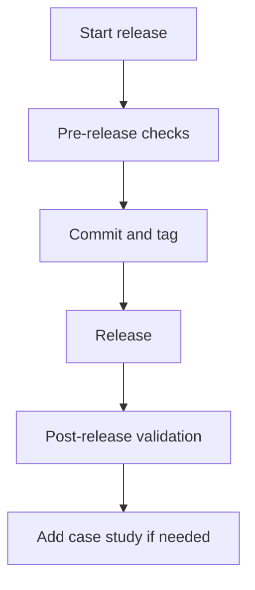

# Release Checklist

Use this checklist before publishing a new quirk Skills version.

## Pre-release

- [ ] Update `VERSION`.
- [ ] Update `CHANGELOG.md`.
- [ ] Update `../explanation/provenance.md` for new, renamed, or retired skills.
- [ ] Update `../reference/agents/skills-map.md` if routing changed.
- [ ] Add or update scenarios for workflow changes.
- [ ] Add or update behavioral fixtures for artifact-template changes.
- [ ] Run `node .agents/skills/platform/check-all.mjs` — full structural, semantic, and security gate.
- [ ] Run `node scripts/generate-site-data.mjs --check` — site drift verification (skills-to-site consistency).
- [ ] Run quality scorer domain consistency check (`total >= 60`).
- [ ] Run prompt regression tests (`node .agents/skills/platform/scripts/test-prompt-regression.mjs <skill> v2`).
- [ ] Commit only scoped release files.
- [ ] Tag as `v<version>`.
- [ ] Push branch and tag.

## Lockfile provenance

`skills-lock.json` pins content and origin for every canonical skill. Two fields
carry the provenance contract, and `validate-skills.mjs` rejects anything else:

| Field | Allowed values | Meaning |
|---|---|---|
| `sourceType` | `local`, `upstream` | Whether the skill is authored here or imported. |
| `revision` | `working-tree` for `local`; the upstream commit or tag for `upstream` | Where the bytes came from. |

- `local` entries always record `revision: "working-tree"`: the hash is the pin
  and there is no upstream revision to name. Do not substitute a commit SHA — it
  would claim provenance the skill does not have.
- A release pins the bundle by tag (`v<version>`) plus the per-skill hash.
- `update-lockfile.mjs` writes the `local` / `working-tree` shape; change an
  `upstream` entry only together with the import that produced it.

## Release

The tag-triggered workflow is `.github/workflows/release.yml`. It validates version equality, runs the full suite and gate (including site drift, quality scorer, prompt regression, and version logging), and then creates the GitHub Release. **There is no npm publication: skills are distributed through the prompt-based installation flow documented in the README.**

- [ ] Commit only scoped release files.
- [ ] Tag as `v<version>`.
- [ ] Push branch and tag.
- [ ] Publish release notes from `CHANGELOG.md`.

**Distribution note:** Skills are not published to npm. They are consumed via prompt-based installation (see README). The workflow enforces this by design — no npm-related steps appear in the release pipeline.

## Post-release

- [ ] Sync one target repo using dry-run first.
- [ ] Run the target repo validation commands.
- [ ] Add a case study if the release exposed a method change.
## Repository update policy

Every mergeable tracked update is a release-metadata update. Unless an explicit exemption applies, the same change must update:

- `VERSION` with the next semver value.
- `CHANGELOG.md` under `## [Unreleased]` with at least one descriptive bullet.
- All hand-maintained version surfaces: `package.json`, `registry.yaml`, `skills.json`, the README version badge, and `.claude-plugin/plugin.json` (the consistency test also checks the generated marketplace projection).

Run `node scripts/check-release-metadata.mjs` and `node --test tests/version-consistency.test.mjs tests/release-metadata-update.test.mjs` before opening a merge request. Generated projections are never hand-edited: run `node scripts/sync-registry.mjs --write` after canonical changes, then inspect the generated diff and run the generated drift checks.

### Explicit exemptions

Use `RELEASE_METADATA_EXEMPTION=generated-only` only when every changed path is a known generated projection. Use `RELEASE_METADATA_EXEMPTION=emergency-maintenance` only for a non-shipping emergency fix and provide a non-empty `RELEASE_METADATA_EXEMPTION_REASON`; record that reason in the change description. Unknown or undocumented exemptions fail validation.

### Version policy

Use MAJOR for breaking workflow or artifact contracts, MINOR for new compatible skills, validators, scenarios, or extensions, and PATCH for documentation or non-breaking fixes. Keep `VERSION` and every hand-maintained surface identical. Add release notes to `Unreleased` before regeneration; when cutting a release, move those notes under `## [<version>] - YYYY-MM-DD`, then tag `v<version>` and push the branch and tag only after all validation passes.
