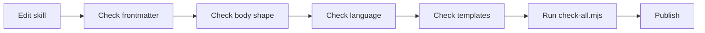

# Skill Style Guide

Use this guide when editing or adding quirk Skills.



## Frontmatter

- `name` matches the folder name.
- `description` states what the skill does and when to use it.
- `capabilities`, `inputs`, `outputs`, `sideEffects`, `stopCondition`, and `risk` must match behavior.
- A skill that writes code, tracker state, branches, PRs, or docs is not `risk: low` unless the write is purely local and explicitly harmless.
- `trustTier` must be declared and must align with `risk`:
  - Tier 1 — metadata/routing only (`ask-to`, `capability-router`)
  - Tier 2 — read-only analysis or documentation (`review-pr`, `research`, `domain-modeling`)
  - Tier 3 — supervised local writes (`implement`, `tdd`, `to-spec`, `plan-review-fixes`)
  - Tier 4 — autonomous remote writes (`publish-open-pr`, `ship-subissue`, `review-fix-loop`)
- `maxIterations` is required on any skill whose body contains an explicit or implicit repeat/loop. Omit it only when the skill is `disable-model-invocation: true` or the body contains no loop at all.

## agentskills.io alignment

The bundle targets the agentskills.io open spec (governed at `agentskills/agentskills`, with the `skills-ref` reference validator and 30+ client implementations), not only Claude Code. Alignment rules for every skill:

- **Six fields are portable cross-harness:** `name`, `description`, `license`, `compatibility`, `metadata`, `allowed-tools`. Everything else in the frontmatter (`category`, `capabilities`, `risk`, `trustTier`, `diataxis`, ...) is bundle-specific.
- **Bundle fields are stripped, not understood.** Outside Claude Code, spec-strict packagers hard-fail on non-spec frontmatter (`Unexpected key(s) in SKILL.md frontmatter`), and lenient clients strip unknown fields. Quirk tooling reads the bundle fields, so they must never carry load-bearing semantics alone: anything a foreign client needs has to be visible in `name`, `description`, `license`, or `metadata`.
- **`compatibility` is a bundle field, not the spec field.** In this bundle it lists the ADJACENT SKILLS of a route; in the spec it is a <=500-character string of environment requirements (intended product, system packages, network access). Same name, different meaning: the divergence is documented, not renamed, with its canonical record in `../reference/agents/skill-templates.md`. New skills must not rely on `compatibility` for environment requirements; use `metadata` if that need ever appears.
- **`name` must equal the folder name** and match `^[a-z0-9]+(-[a-z0-9]+)*$`: lowercase letters, digits, single hyphens, no `anthropic`/`claude`, at most 64 characters.
- **`description` discipline:** non-empty, at most 1024 characters, no XML tags. The description is the trigger surface, so state what the skill does and when to use it, in the third person, and never assume a bundle-only field is present to interpret it.
- **`license`:** every skill declares `license: MIT`, quoted or plain to match the file's local frontmatter dialect. The two skills pinned by the wave-0 frontmatter guard (`code-review`, `subagent-swarm`) declared it once the guard's sanction list was extended with `license`.
- **Body budget:** keep `SKILL.md` under 500 lines (spec recommendation) and `references/` one level deep. Wave-1 exception: philosophy-carrying skills may legitimately exceed the budget; keep load-bearing content near the top anyway, because compaction keeps the start of a re-injected body.

Gate the alignment with `node .agents/skills/platform/validate-spec-compliance.mjs`: name and description violations exit 1, while body-length, truncation, and backslash findings are warnings.

## Body Shape

- Start with the purpose and boundary.
- Include a `Contract` section for non-trivial skills.
- Include ordered steps only when sequence matters.
- Include completion criteria that are checkable.
- Push mode-specific details into references instead of bloating `SKILL.md`.

## Language

- Use quirk vocabulary from `CONTEXT.md` and `../explanation/quirk-method.md`.
- Avoid person-branded names and repository-specific examples.
- Prefer "source of truth", "scope", "validation", "owner", and "next consumer" over vague status language.

## Templates

- Follow the template owned by the skill you are editing, and keep shared artifact principles in `../reference/agents/skill-templates.md`.
- Treat the skill-specific template as the source of truth for shape, and keep the repository-level index as the map, not the contract.
- Published artifacts must not contain placeholders.
- Use examples only when they are generic or clearly marked as examples.
- If a skill produces a new durable artifact shape, add a new skill-owned reference instead of teaching the whole repo a new generic template.

## Validation

After every skill edit:

```bash
node .agents/skills/platform/check-all.mjs
```
