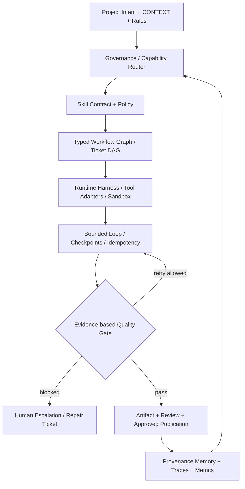
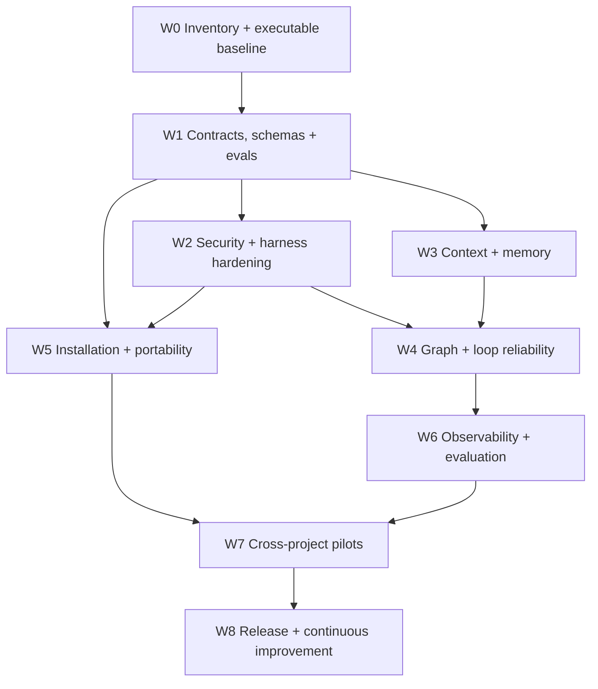

# Quirk Skills — Strategic Implementation Plan (2026–2027)

**Status:** approved planning baseline; execution NOT STARTED. **Date:** 2026-10-26. **Target:** cross-project, portable, evaluable agent-skills engineering platform. **Scope:** canonical skills, governance, runtime, evaluation, security, installer, docs, packaging and release. **Non-goal:** replace the ecosystem with a mandatory monolithic orchestration framework.

This plan extends [Engineering Evolution](engineering-evolution-2026.md), [Agent Engineering Methodologies](../../explanation/agent-engineering-methodologies-2026.md), and [Installation Options](../../how-to/installation-options.md). Every feature claim needs tests; listed scripts are discovery points, not verified successes.

## 1. Operating principles and constraints

1. **Reuse before rewrite.** Measure and inventory existing capabilities before adding any new skill, runtime or dependency.
2. **Canonical source only.** Edit `.agents/skills/<domain>/<skill>/SKILL.md`; never hand-edit `.claude/skills/`, catalogs or other generated projections. Update `skills-lock.json` and regenerate on skill changes via documented commands.
3. **Contracts over prompts.** Each workflow change includes inputs, outputs, permissions, invariants, acceptance criteria, termination and fallback.
4. **Safety before autonomy.** Read-only by default; explicit authority for remote writes, merges, deployments and destructive side effects. Injection-resistance and least agency are mandatory gates.
5. **Evidence before merge.** Capture pre/post baselines, fixture results, logs, reproduction steps and rollback; distinguish PASS, FAIL, BLOCKED and NOT RUN.
6. **Project neutrality.** Framework, language, tracker, cloud, model, provider and memory backend are replaceable adapters. Minimal install must not require the full harness.
7. **Incremental changes.** Scope each ticket to one vertical slice. Prefer PR review on an isolated branch even if publishing ultimately targets `main`. No unreviewed mass-reformatting or speculative renames.
8. **Preserve backward compatibility** unless an ADR, migration, version bump, release notes and rollback explicitly approve a break.

## 2. Architecture target and contracts



**Contract object (proposal; versioned before implementation):** `skill_id`, `contract_version`, `capabilities`, `input_schema`, `output_schema`, `required_permissions`, `side_effects`, `risk_tier`, `stop_condition`, `max_iterations`, `timeout`, `idempotency_scope`, `evidence_requirements`, `fallback`. Keep cross-client fields compliant with Agent Skills; bundle-only fields must never silently become required for third-party clients.

**Execution envelope (proposal):** `run_id`, `trace_id`, `work_item_id`, `skill_id`, `attempt`, `state`, `input_ref`, `artifact_refs`, `policy_decision`, `validation_refs`, `timestamp`. Do not persist secrets or personally identifiable payloads in telemetry.

**Workflow states (proposed):** `discovered -> planned -> authorized -> running -> validating -> review -> completed`; exception branches `retryable_failed`, `blocked`, `needs_approval`, `failed`, `cancelled`. All transitions must be checked against allowed state and permission changes; no bypass of review or publication approval through parallel paths.

## 3. Program structure and dependency order



Sequencing is dependency-driven, not calendar-driven. Run W2, W3 and W5 on isolated branches when they do not share canonical contracts. No dependent ticket is claimable before prerequisite acceptance evidence is linked.

### W0 — Inventory, source reconciliation and executable baseline (P0)

**Inspect:** every canonical `SKILL.md`, `registry.yaml`, `skills-lock.json`, compatibility views, manifests, `package.json`, CI scripts, fixture suites, installer paths and documentation links. Derive counts from the filesystem and registry; classify entries `canonical`, `alias`, `generated`, `deprecated`, `platform`, `missing`.

**Actions:** record commit SHA, environment, Node/npm versions; run `npm test`, `node .agents/skills/platform/check-all.mjs`, `npm run evals:routing:check`, `npm run evals:behavioral:mock`, `npm run scan:skills`, `npm run traceability`, `npm run audit:context` and `npm run memory:check`. Capture stdout, exit status and duration independently; diagnose rather than hiding pre-existing failures. Run all non-mutating commands in a clean checkout; isolate generators.

**Deliverables:** machine-readable inventory, capability/owner matrix, baseline report, broken-link inventory, defect register, risk register, reproducible commands and environment manifest.

**Exit gate:** 100% canonical skills inventoried; every baseline command marked PASS/FAIL/BLOCKED/NOT RUN with artifact or reason; all critical unknowns become explicit tickets. No requirement that pre-existing baseline be green, only that it be trustworthy.

### W1 — Contract and evaluation foundation (P0)

**Targets:** `ask-to`, `work-item-router`, `to-spec`, `to-tickets`, `implement`, `review-pr`, `review-fix-loop`, `evaluate-skill`, `skill-quality-gate`; extend incrementally to the rest of inventory.

**Actions:** harmonize routing triggers and non-triggers, side-effect declarations, risk tiers, stop conditions and outputs without gratuitous frontmatter changes. Add deterministic fixtures for happy path, failure path, ambiguous routing, invalid schema, missing context, boundary violation and no-op. Define immutable fixture IDs and compare baseline/candidate.

**Acceptance:** all modified skills have positive/negative trigger fixtures, explicit invariant checks and verified non-action cases; 100% required security fixtures pass; no unexplained regressions. Track route precision/recall and task success **relative to baseline**; do not set unmeasured absolute claims.

### W2 — Harness, policy and supply-chain security (P0)

**Targets:** permission broker, tool adapters, project sandbox, security scanner, side-effect auditor, MCP boundary, approval checkpoints, lockfile and dependency provenance.

**Actions:** separate read/analyze/local write/remote write/deploy/merge permissions; test prompt injections in retrieved docs, tickets, tools and MCP responses; deny unknown destinations; add cancellation, timeout, resource limits and audit logs. Verify symlink escapes and path traversal protections. Make credentials ephemeral; redact logs. Check installer integrity and dependencies.

**Acceptance:** zero unauthorized side effects across adversarial fixtures; explicit, traceable approval on privileged transitions; deterministic policy outcomes, and no secret leakage in test logs. Blocking security findings must be fixed before promotion.

### W3 — Context and memory engineering (P1)

**Targets:** `context-pack`, context-budget auditor, memory index and handoff artifacts.

**Actions:** classify operational context (user intent, project state, contracts, tool outputs), rank by provenance and freshness, load just-in-time; test context compaction against lost constraints; define memory write eligibility, schema, TTL, invalidation, source references, and deletion controls. Keep ephemeral context distinct from durable ADRs and validated memory.

**Acceptance:** golden scenarios preserve all must-retain constraints after compaction; memory reads have inspectable provenance; expired/revoked entries cannot affect decisions; no sensitive payloads stored by default.

### W4 — Graph and loop execution reliability (P1)

**Targets:** workflow-state-machine, loop runner, dependency graph, ticket DAG, `parallel-issue-fleet`, `worktree-swarm`, replay and idempotency.

**Actions:** typed nodes and edges with validated DAGs; explicit guards and transition logs; bounded retry/backoff/timeout/cancellation; durable checkpoints and safe restart; immutable artifacts per task; restricted parallel fan-out and deterministic convergence; conflict ownership protocol and approval nodes.

**Acceptance:** fixtures for cycle rejection, timeout, cancellation, duplicate remote side effect, crash/resume and concurrent overlap; no duplicated writes after replay; no path from execution to publication without approval and clean review.

### W5 — Installation, interoperability and portability (P1)

**Targets:** existing `bin/skills-quirk.js`, `scripts/setup-quirk-skills.sh`, `scripts/install-quirk-skills.sh`, `sync-bundle.mjs`, manifests and agent-native views.

**Actions:** evaluate `npx skills add quantumquirkxyz/skills-quirk --list` and selective installs in disposable projects before endorsing; verify nested skill discovery and references. Audit current destructive copy behavior. Introduce separate modes only if justified: `inspect` (read-only), `install` (safe and conflict-aware), `upgrade` (diff/backup), `verify`, and optional `uninstall` (tracked manifest and non-destructive). Prefer standard ecosystem CLI; preserve existing CLI aliases. Document Node/platform support and pinning.

**Acceptance:** clean-project and existing-project fixtures on Linux, macOS and Windows where supported; no silent overwrite of unrelated files; second install idempotent; optional selected-skill mode does not imply whole-harness installation; rollback tested; unsupported combos clearly documented.

### W6 — Observability, benchmarks and evaluation-driven promotion (P1)

**Targets:** metrics, traceability, audit trail, benchmark harness, evaluation reports.

**Actions:** correlate `trace_id`, skill, attempt, artifact and decision; version schema; expose OpenTelemetry adapter only when compatible; track correctness, triggers, failure classes, p50/p95 latency, tokens/cost when available and retry overhead. Guard against benchmark contamination, unreviewed generated oracle answers and flaky fixtures.

**Acceptance:** reproducible baseline-versus-candidate scorecard; regression detection; audit trail replays a representative workflow; telemetry redaction tests; critical security/contract regressions always block release regardless of aggregate score.

### W7 — Cross-project verification and usability pilots (P1)

Test on **at least five representative fixtures**: TypeScript fullstack, Python API/data pipeline, ML/research, IoT/embedded, and blockchain/contracts. Each includes new/existing-repo paths, minimal versus full-harness install, a feature, bug fix, review-repair, and simulated recovery. Domain-specific tools remain optional. Capture actual usability failures and installation friction.

**Acceptance:** all mandatory acceptance scenarios pass in each supported configuration; unsupported combinations are documented, not advertised; complete setup time and commands are measured; an independent maintainer can reproduce at least one end-to-end flow from docs.

### W8 — Release and continuous improvement (P2)

Update version and changelog; follow [Release checklist](../../how-to/release.md). Publish migration notes, security model, platform compatibility and release evidence; tag only after full release gates pass. Maintain a quarterly review cycle for dependencies, protocols, performance and retired skills. Deprecate through warnings and migration intervals before removal.

**Acceptance:** release artifacts match the tagged source; install tests run against the published artifact; upgrade/rollback documented; no unreviewed critical findings.

## 4. Skill portfolio migration

Prioritize by **risk × usage × dependency centrality × evidence gap**, not alphabetically. Initially audit 100% and migrate high-impact skills in controlled batches. Inventory classes: (A) router/governance; (B) implementation/review; (C) evaluation/security; (D) context/memory; (E) infrastructure and language-specific; (F) low-risk supporting; (G) aliases/deprecated. Assign an explicit owner, source path, consumers, fixtures and change reason to every migration. No blanket rewriting.

Suggested first migration batch: `work-item-router`, `ask-to`, `evaluate-skill`, `skill-quality-gate`, `implement`, `review-pr`; subsequent batch `to-spec`, `to-tickets`, `review-fix-loop`, `context-pack`, memory/loop/graph executors and installers. Resolve exact canonical paths during W0; names in this plan are discovery labels.

## 5. Ticket and commit protocol

Use the existing GitHub issue tracker and [Work Item Format](work-item-format.md). Parent spec covers the program; tickets correspond to a single vertical slice with metadata, dependency links, owner, scope, risk, files, reproducible baseline, tests, migration/rollback, and evidence URL.

**Per-ticket sequence:** `work-item-router → triage → to-spec (parent only) → to-tickets → implement → run narrow tests → regenerate canonical projections as required → full check-all → publish-open-pr → review-pr → review-fix-loop if needed → ship-subissue`. Run the workflow as far as available tools permit; never mark omitted stages completed. Publish/merge authority must remain separate from review evidence even when target branch is `main`.

Commit messages **in English**, one responsibility per commit, e.g.: `test(evals): add negative routing fixtures`, `fix(policy): deny unapproved remote writes`, `feat(runtime): persist resumable workflow checkpoints`, `fix(installer): preserve pre-existing project files`, `docs(adoption): clarify selective installation`. Avoid direct mass writes to `main` for risky work; integration lands in `main` only after gates and review.

## 6. Program KPIs and go/no-go decisions

| Metric | Measurement | Release criterion |
|---|---|---|
| Inventory completeness | Audited canonical entries / discovered canonical entries | 100% |
| Critical safety regressions | Failing required negative/permission fixtures | 0 |
| Contract regression | Failing required assertions in modified skills | 0 unexplained |
| Routing effectiveness | Precision/recall on versioned positive + negative corpus | >= baseline, with explicit known exceptions |
| Replay correctness | Recovered runs without duplicated side effects / tested recoveries | 100% on mandatory deterministic cases |
| Install safety | Unexpected modified/deleted project paths / install scenario | 0 |
| Installer idempotence | Divergence after repeated no-change installs | 0 |
| Traceability | Completed tickets with acceptance evidence + linked artifacts / completed tickets | 100% |
| Documentation correctness | Broken internal links across maintained docs | 0 on checked scope |
| Compatibility | Supported target matrix with passing installation + scenario fixtures | 100% of advertised combinations |

Latency, cost, task success and developer setup time have **no fabricated thresholds**; collect baseline and ratify targets with benchmark evidence. Every KPI must include test corpus version, runner version, commit and environment.

## 7. Risk register and mitigations

- **Unverified existing functionality:** inventory and run baseline before claiming implementation; log NOT RUN explicitly.
- **Mass migration breaks clients:** retain compatibility aliases; schema versioning, migration docs and canary tests.
- **Installer damages projects:** inspect/dry-run, allowlist, backups, conflict-aware writes and disposable fixtures.
- **Autonomy bypasses controls:** fail-closed permission gates, negative tests, independent review of side effects.
- **Stale memory or injected context:** provenance validation, TTL, tainting and adversarial fixtures.
- **Race conditions and non-idempotent retries:** execution leases, isolated workspaces and deduplication keys.
- **Generator drift:** run documented lockfile/registry/site generation steps; prohibit hand-editing projections.
- **Evaluation overfitting:** hidden negative examples, fixed corpus versions and manual oracle review.
- **Tooling mismatch:** optional adapters, minimal install path, documented supported matrix.
- **Direct-main changes reduce reviewability:** use short-lived issue branches, tracked approvals and gated integration, even though `main` is the desired destination.

## 8. Definition of done

The program is **not done** merely because documentation exists, a CLI command is advertised, or one benchmark passes. Completion requires: inventoried and assessed canonical skill portfolio; validated priority migrations; bounded graph/loop operation; least-privilege and safe replay; explainable memory/context decisions; passing compatibility and installation matrix; complete test and rollback evidence; documented release; published and reproducible version. If a capability is intentionally deferred, mark the precise limitation and do not represent it as implemented.

## 9. First executable backlog (in dependency order)

| ID | Work item | Dependencies | Evidence |
|---|---|---|---|
| QS-00 | Record current commit, branch, toolchain, baseline commands and failures | none | Baseline JSON + logs |
| QS-01 | Build canonical inventory and classify skill lifecycle/owners/centrality | QS-00 | Inventory JSON + review |
| QS-02 | Audit generated projections, links, installer and third-party CLI discovery | QS-00 | Reproducible defect register |
| QS-03 | Version behavioral contracts and negative routing fixtures for core skills | QS-01 | Golden corpus + diff |
| QS-04 | Add policy and adversarial harness test matrix | QS-01, QS-03 | Rejected-side-effect cases |
| QS-05 | Implement bounded state transitions, replay and idempotency upgrades | QS-03, QS-04 | Crash/retry fixtures |
| QS-06 | Validate context budgets and memory provenance/TTL | QS-03 | Compaction and freshness fixtures |
| QS-07 | Implement installer safety only where CLI/sync tests demonstrate gaps | QS-02, QS-04 | Cross-platform smoke report |
| QS-08 | Integrate trace/metrics and baseline comparisons | QS-05, QS-06 | Evaluation scorecard |
| QS-09 | Run five cross-project pilots | QS-07, QS-08 | Reproducible acceptance suite |
| QS-10 | Release, document migrations and rollback | QS-09 | Tagged release and CI artifacts |

Each QS item must become a fully specified tracker-backed ticket before implementation; identifiers here are **planning keys**, not assertions that GitHub issues already exist.

## Implemented increment (2026-10-26): deterministic action policy

The new `.agents/skills/platform/action-policy.mjs` exports a **pure**, deny-by-default `authorizeAction(request, grant)` decision primitive. It enforces known action categories, explicit resource allowlists, trusted origin for any write, and an approval ID bound to the exact action/resource for remote-write, deployment, merge and destructive actions. Regression tests live in `tests/action-policy.test.mjs` and are included in the repository's normal `npm test` glob.

This is **not yet a runtime-enforced permission broker**: existing tool invocations are not automatically intercepted. Integrate this primitive at each actual tool boundary only after identifying the authoritative caller, validating grant provenance, adding tamper-resistant approvals, and running adversarial integration tests. A caller-supplied `origin: trusted` is not an authentication mechanism.

**Local isolated proof:** four unit cases passed under Node.js 22.16.0 in a reconstructed fixture with identical module logic; the remote repository's full CI has NOT been verified. The release gate remains blocked until the implementation is validated in GitHub CI.

## Implemented increment: opt-in memory provenance validation

The existing memory-index validator now supports `--require-provenance` and `--as-of YYYY-MM-DD` for deterministic, backwards-compatible provenance and expiry validation. Memory notes are checked for `[source: reference; added: YYYY-MM-DD]` and may declare `[expires: YYYY-MM-DD]`. The default check behavior is unchanged until projects opt in.

Example: `node .agents/skills/platform/memory-index.mjs check .agents/memory --require-provenance --as-of 2026-10-26 --json`.

Fixtures: `tests/memory-provenance.test.mjs`. This is not a full memory policy engine: source references are syntactically checked rather than independently verified, and the implementation has not passed full remote CI yet. Memory storage consent, deletion semantics and all downstream runtime retrieval filters remain separate work items.

## Implemented increment: loop budget and MCP boundary hardening

The existing `loop-runner.mjs` now rejects invalid budgets (including negative limits and malformed repeat thresholds) before executing work. Negative/nonfinite per-step cost is treated as a format error and charged at the default cost, preventing budget underflow. Regression fixtures: `tests/loop-budget-safety.test.mjs`.

The existing read-only MCP HTTP server now binds to `127.0.0.1` by default; binding to a non-loopback host requires `QUIRK_MCP_ALLOW_REMOTE=1`. Requests greater than 1 MiB receive HTTP 413. Regression fixtures: `tests/mcp-server-safety.test.mjs`. Remote exposure still requires independent authentication, TLS, access controls and deployment review, which this HTTP server does **not** implement.

These are targeted code changes, not confirmation that W2/W4 are complete. The full repository CI, adversarial permission tests at live tool boundaries, multi-process replay, and distributed convergence remain outstanding.

## Implemented increment: evaluation scorecards

The new `scripts/baseline-scorecard.mjs` compares two baseline JSON reports by check ID, fails closed on missing check IDs, identifies `PASS -> FAIL/BLOCKED/NOT RUN` regressions, and supports `--strict` mode to require all candidate checks to pass. Regression tests: `tests/baseline-scorecard.test.mjs`.

Example:

```bash
npm run baseline:compare -- --baseline /path/to/previous.json --candidate /path/to/current.json --strict
```

This is a deterministic **gate outcome comparator**, not an LLM-quality judge, not proof of benchmark coverage and not an automatic deployment authorization. Published artifacts and a fixed corpus must be reviewed independently. Four comparator unit cases passed in a self-contained Node.js 22.16.0 fixture; the full repository CI is not yet verified.

## 10. Validation command reference (from package scripts)

```bash
npm test
node .agents/skills/platform/check-all.mjs
npm run evals:routing:check
npm run evals:behavioral:mock
npm run scan:skills
npm run traceability
npm run audit:context
npm run memory:check
```

These commands must be executed from a valid checkout; listing them does not constitute passing results.
